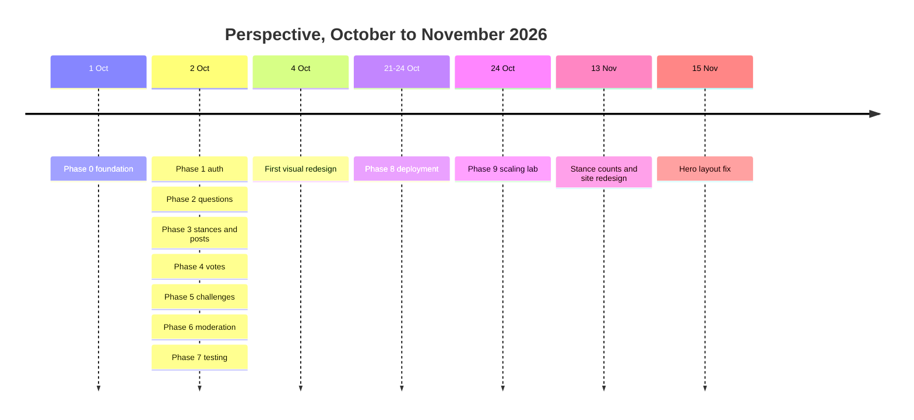

# Development Timeline

Recovered from the git history (51 commits, 1 October to 15 November 2026), the roadmap's Decision Log and the earlier session records. Dates are commit dates.

**A note on the commit style:** the first seven commits use Conventional Commits (`feat(api): ...`, `chore: ...`). From `75b40b8` on they are short plain descriptions. That change was the owner's preference, recorded as D29 (which supersedes D23).

## Phase overview

The very compressed dates (phases 1–7 all on 2 October) reflect autonomous implementation sessions: Claude built each phase end to end, then the owner reviewed and approved it before the next one started.

## Phase 0: Foundation (1 October)

| Commit    | What happened                                                                                                |
| --------- | ------------------------------------------------------------------------------------------------------------ |
| `0b78cf8` | pnpm monorepo skeleton: `apps/web`, `apps/api`, `packages/shared`                                            |
| `d4bd797` | Strict TypeScript, type-aware ESLint, Prettier                                                               |
| `5d537ba` | Postgres in Docker Compose with the two least-privilege roles (D19)                                          |
| `d93b691` | Environment validation with Zod: the API refuses to start on bad config                                      |
| `efc5a4f` | Fastify server: health checks, Pino logging, central error handler (D22)                                     |
| `8f4d0c2` | Drizzle ORM and the migrations workflow; readiness check                                                     |
| `8cb8716` | README with setup guide                                                                                      |
| `34a4623` | Roadmap updated: Google sign-in, UUIDv7 ids, secure account linking planned before any auth code was written |

**Decisions made here (owner's choices):** shared package consumed as TypeScript source (D17, "option A"), two database roles (D19, "option 2"), Zod + one root `.env` (D20, D21), custom error format (D22, "option 2").

**HISTORY:** the owner said at this point, "for all the past steps I have understood nothing. Where are we actually going to build the website?" The answer was to stick to the plan: foundations first. That moment shaped how explanations were written from then on (big picture first, plain language). It is also the reason for the line-by-line learning tour later.

## Phase 1: Authentication (2 October)

| Commit    | What happened                                                                                 |
| --------- | --------------------------------------------------------------------------------------------- |
| `75b40b8` | `users` and `sessions` tables                                                                 |
| `2e28347` | Working agreement updated: autonomous workflow, plain commit messages                         |
| `07a3ff6` | Email + password API: argon2id, session cookies, Origin-check CSRF, helmet, CORS, rate limits |
| `3dc8a4f` | Sign-up, log-in and account pages (React, React Router, TanStack Query)                       |
| `69ac451` | TanStack Query pinned to respect pnpm's release-age policy                                    |
| `ce84d2d` | Sign in with Google and secure account linking (D27, D34)                                     |
| `76d0100` | Email verification and password reset (D35)                                                   |
| `e994d9c` | Role guards; one-time codes redacted from logs                                                |
| `df41c4f` | Roadmap: Google sign-in marked done                                                           |

**HISTORY:** the owner asked to add Google sign-in at the start of Phase 1 ("rather than just using mail and password") and set the security requirement explicitly: _do not automatically link accounts solely because their email addresses match_. That became D27.

## Phases 2–7 (2 October)

| Commit    | Phase | What happened                                                   |
| --------- | ----- | --------------------------------------------------------------- |
| `36af3ec` | 2     | Questions API: full-text search, trigram "did you mean…?"       |
| `6f63802` | 2     | Question pages: browsing, search, duplicate suggestions         |
| `9b9cecd` | 3     | Stances and posts API                                           |
| `1b2bc79` | 3     | Stance picker, post columns, Markdown editor                    |
| `ab88bfa` | 4     | Helpful votes with cross-side weights; Top and Hot sorting      |
| `2c3579f` | 4     | "Helped me understand" button, cross-side badge, sort switch    |
| `483f7ca` | 5     | Challenges, threaded comments, notifications API                |
| `c937a30` | 5     | Challenge pages, threads, notifications UI                      |
| `debcefc` | 6     | Reports, moderation actions, append-only audit log, spam checks |
| `dbeb7d3` | 6     | Report buttons and moderator dashboard                          |
| `908683a` | 7     | Shared validation tests, coverage, server tests, seed script    |
| `ecaacff` | 7     | Playwright end-to-end tests                                     |

Owner decisions: questions publish immediately for verified users (D37, "option A"); vote weights 1/2/3 and a 24-hour account age for voting (D44/D45, "1(A) and 2(B)").

## First redesign (4 and 21 October)

| Commit    | What happened                                                                                                              |
| --------- | -------------------------------------------------------------------------------------------------------------------------- |
| `58173ee` | Front page and theme redesigned around the owner's artwork (cream and brick red, Open Sauce One). Dark mode removed (D55). |
| `d465cd9` | Artwork fitted to every screen size (it was being cut off on the owner's ~1998×985 screen)                                 |

## Phase 8: Deployment (21–24 October)

| Commit    | What happened                                                                                                |
| --------- | ------------------------------------------------------------------------------------------------------------ |
| `25d7238` | Docker images, CI, migrations on deploy, SMTP email, trusted proxies                                         |
| `a99acf9` | Hosting configs (Vercel, Render), the proxy secret (D61), hosted-database role setup (D62), security updates |
| `4d1ea39` | Hosting decision recorded (D63)                                                                              |
| `94b0680` | zod, undici and fast-uri updated for security advisories; Dependabot skips major Node bumps                  |
| `6bc7075` | Roadmap: CI and audit ticked                                                                                 |
| `46682dc` | The website wakes the sleeping API and retries while it starts (D64)                                         |
| `00baaed` | Roadmap: deployment ticked                                                                                   |

**HISTORY: the hosting saga.** The owner is a student and asked for a **$0** deployment. The first proposal was Koyeb for the API, but Koyeb had closed its free plan to new accounts. Render was chosen instead. That ruled out Netlify for the website: Netlify's proxy gives up after 26 seconds, while Render needs about a minute to wake up. Vercel waits up to 120 seconds, so Vercel won. Render's free plan blocks the normal mail ports, so Brevo's port 2525 was used. Finally, the live site showed that Render doesn't wake up for requests that come through a proxy; that led to the browser-side wake-up (D64). The full story is in [DEVELOPMENT_ISSUES.md](../08_BUGS_AND_DEBUGGING/DEVELOPMENT_ISSUES.md).

## Phase 9: Scaling lab (24 October)

| Commit    | What happened                                                            |
| --------- | ------------------------------------------------------------------------ |
| `d7d2805` | Load-test tooling (k6, 4.4 M-row database) and baseline numbers          |
| `9bfa006` | Post-column indexes matched to the listing filter (D66): 3.0 ms → 0.4 ms |
| `635bad2` | Redis cache for logged-out pages with versioned invalidation (D67)       |
| `1e875e9` | Rate limits in Redis; several API instances behind nginx (D68, D69)      |
| `0d30b82` | Email queue on BullMQ with a separate worker (D70)                       |
| `db63374` | Read replica with read-your-writes via WAL positions (D71)               |
| `12ba922` | Decision: keep Postgres search for now (D72)                             |
| `724f2cd` | Prometheus metrics, Grafana dashboard, OpenTelemetry tracing (D73)       |
| `fdabb2a` | Phase 9 summary table                                                    |

## After the roadmap (13–15 November)

| Commit    | What happened                                                                                                                                              |
| --------- | ---------------------------------------------------------------------------------------------------------------------------------------------------------- |
| `834a28a` | Stance counts stored on `questions`; "Most active" and "Most divided" sorts (D74)                                                                          |
| `feb21af` | Site redesign: landing page, `/questions` browse page, header with phone menu, footer, split-screen auth, post page, column tabs on phones, 404 page (D75) |
| `cdd117f` | Front-page hero fitted between header and artwork on short laptop windows                                                                                  |

**HISTORY:** between Phase 9 and the redesign, the owner started a line-by-line **learning tour** of the codebase (13 modules). Module 1 (setup, lessons 1–4) and Module 2 lessons 1–2 (database) were completed before the tour was paused for the redesign. This knowledge base is the continuation of that goal. See [COMPLETE_LEARNING_ROADMAP.md](../10_LEARNING_ROADMAP/COMPLETE_LEARNING_ROADMAP.md).

## What the history does not record

- **Exact reasoning for some small choices** (for example the specific rate-limit numbers, such as 30 stance changes per hour) is not written down anywhere. Where this knowledge base explains them, the explanation is a reconstruction and is labelled as such.
- **Bugs fixed before a commit** are mostly not visible in git, because each phase was committed once it worked. The ones recoverable from session records are in [BUGS_AND_FIXES.md](../08_BUGS_AND_DEBUGGING/BUGS_AND_FIXES.md).
