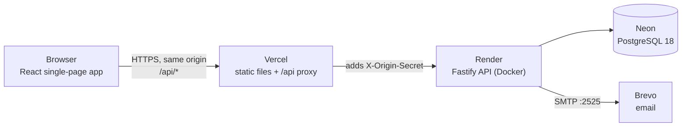

# Project Overview

> **Labels used throughout this knowledge base**
>
> - **FACT**: verified directly in the code, the git history or the live site (November 2026).
> - **HISTORY**: a decision or event recovered from the roadmap's Decision Log, commit messages or earlier session records.
> - **RECOMMENDATION**: an opinion about what could be improved. Not implemented.

## What Perspective is

Perspective is an opinion platform built around one idea: **understand viewpoints before debating them.**

Most discussion sites reward agreement: you upvote what you already believe, and disagreement turns into a comment war. Perspective changes the structure of the conversation instead:

1. **Every topic is a question** that can be answered For, Neutral or Against (for example "Should cities ban cars downtown?"). A topic like "abortion" can't be split three ways; "Should abortion be legal?" can (Decision D3).
2. **The question page shows three columns side by side**, For / Neutral / Against. Each column holds _posts_ that explain the reasoning behind that stance.
3. **You declare your own stance** before you can write or vote on a question.
4. **The only vote is "This helped me understand".** There are no downvotes (D9). A vote from someone on the _opposite_ side is worth more (weight 3) than one from your own side (weight 1). So the ranking rewards posts that make the other side understand, not posts that please your own side (D10, D44).
5. **Debate happens only inside Challenges.** If you disagree with a post, you open a challenge on it, and a threaded discussion happens there. The columns stay calm and readable.
6. **Moderation**: reports, moderator removal and restore, bans, an append-only audit log and automated spam checks.

## Who built it and why

**HISTORY:** The project owner built Perspective as a **learning project focused on system design and scalability**, with Claude implementing under a written working agreement (`CLAUDE.md`). The owner made every major product and architecture decision (marked 🟡 in the roadmap); Claude implemented each phase, verified it, documented it and committed it. The owner was learning TypeScript and PostgreSQL for the first time during the project.

The goals were:

- A complete, real product (not a tutorial clone) that can be shown to recruiters.
- Production-grade security from the first line of auth code, not bolted on at the end.
- A real deployment at **$0** (free tiers, no payment card).
- A **scaling laboratory**: millions of generated rows, load tests, and measured before/after numbers for every scaling technique (indexes, caching, multiple instances, a job queue, a read replica, observability).

## The system in one picture

- **The website** (`apps/web`) is a React app that only draws pages and calls the API.
- **The API** (`apps/api`) is a Fastify server that enforces every rule: who is logged in, what they may do, what is valid.
- **The database** (PostgreSQL) stores everything and enforces many rules itself (unique indexes, check constraints, foreign keys).
- **Shared code** (`packages/shared`) holds the validation rules and types that both the website and the API use, so they can never disagree.

Details: [SYSTEM_ARCHITECTURE.md](../01_ARCHITECTURE/SYSTEM_ARCHITECTURE.md).

## How a typical visit works

1. A visitor opens the site. Vercel serves the static React app.
2. The React app asks the API `/api/auth/me` (am I logged in?) and `/api/questions?sort=active&limit=6` (questions for the landing page).
3. The visitor opens a question. The app loads the question and its three columns (three separate API calls, one per stance).
4. They log in. The API checks the password with argon2id, creates a session row (storing only a hash of the token), and sets an `httpOnly` cookie.
5. They pick a side. The API records the stance in a database transaction that also updates the question's counts and logs the change in history.
6. They mark a post "Helped me understand". The API stores the vote together with the voter's stance at that moment and updates the post's score in the same transaction.

Every one of these flows is traced end to end in [REQUEST_RESPONSE_FLOWS.md](../01_ARCHITECTURE/REQUEST_RESPONSE_FLOWS.md).

## Where things live

| You want to understand…                     | Read                                                                                                            |
| ------------------------------------------- | --------------------------------------------------------------------------------------------------------------- |
| Every feature, and whether it really exists | [COMPLETE_FEATURE_INVENTORY.md](COMPLETE_FEATURE_INVENTORY.md)                                                  |
| Which libraries are used and why            | [TECHNOLOGY_STACK.md](TECHNOLOGY_STACK.md)                                                                      |
| How the project was built over time         | [DEVELOPMENT_TIMELINE.md](DEVELOPMENT_TIMELINE.md)                                                              |
| What is deployed right now                  | [CURRENT_PROJECT_STATUS.md](CURRENT_PROJECT_STATUS.md)                                                          |
| One feature in depth                        | [04_FEATURE_DEEP_DIVES/](../04_FEATURE_DEEP_DIVES/)                                                             |
| PostgreSQL, taught through this project     | [05_DATABASE/DATABASE_FUNDAMENTALS.md](../05_DATABASE/DATABASE_FUNDAMENTALS.md)                                 |
| TypeScript, taught through this project     | [06_TYPESCRIPT_AND_BACKEND/TYPESCRIPT_FUNDAMENTALS.md](../06_TYPESCRIPT_AND_BACKEND/TYPESCRIPT_FUNDAMENTALS.md) |
| How to study all of this                    | [10_LEARNING_ROADMAP/COMPLETE_LEARNING_ROADMAP.md](../10_LEARNING_ROADMAP/COMPLETE_LEARNING_ROADMAP.md)         |

## Relationship to the existing docs

This knowledge base **does not replace** the repository's own documents. They remain the source of truth:

- [`docs/ROADMAP.md`](../../docs/ROADMAP.md): the plan, the Decision Log (D1–D75), the data model and the security checklist.
- [`docs/DEPLOYMENT.md`](../../docs/DEPLOYMENT.md): step-by-step $0 deployment.
- [`docs/SCALING.md`](../../docs/SCALING.md): the Phase 9 measurements.
- [`README.md`](../../README.md): local setup and scripts.

This knowledge base explains _why_ and _how_ in more depth, follows the code line by line, and teaches the underlying concepts. Decision numbers like "D27" refer to the Decision Log in `docs/ROADMAP.md`.
