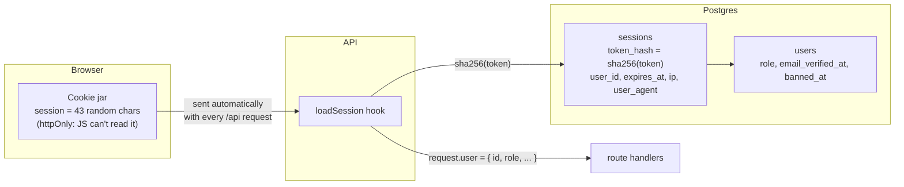
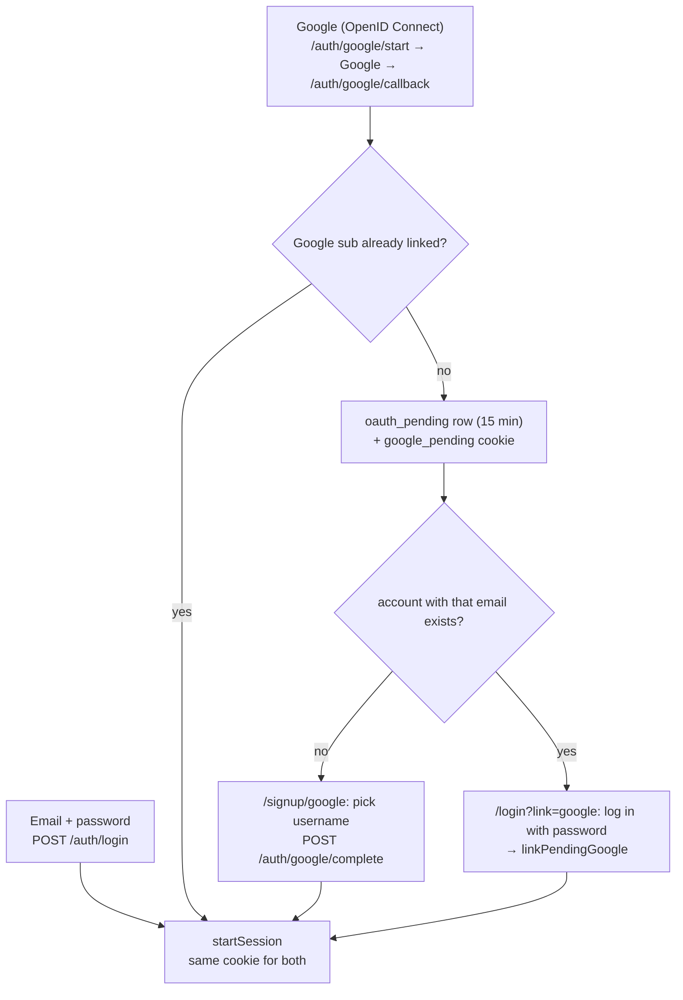

# Authentication Architecture

**Authentication** answers "who are you?". **Authorization** answers "what may you do?". Perspective does both on the server, on every request.

## The core design: server-side sessions in an httpOnly cookie (D12)

- After login, the browser holds a random **token** (32 bytes from Node's cryptographic random number generator, base64url-encoded: 43 characters).
- The database stores only the **SHA-256 hash** of that token (`sessions.token_hash`). If the database leaked, the hashes couldn't be turned back into working cookies.
- On every request, `loadSession` (`plugins/auth.ts:20`) hashes the cookie, looks up the session joined with the user, and sets `request.user`.
- Because the user row is read fresh **every time**, a role change, a ban or an email verification takes effect on the very next request (D36). A JWT would carry a copy of the role until it expired.

Why not JWTs in localStorage? The full comparison, including what httpOnly, Secure and SameSite do and what happens without them, is in [COOKIE_SECURITY.md](../07_SECURITY/COOKIE_SECURITY.md) and [AUTHENTICATION_DECISIONS.md](../03_TECHNICAL_DECISIONS/AUTHENTICATION_DECISIONS.md).

## Session lifecycle

| Event                                             | Code                                 | What happens                                                                                                                                         |
| ------------------------------------------------- | ------------------------------------ | ---------------------------------------------------------------------------------------------------------------------------------------------------- |
| Login / sign-up / Google sign-in / password reset | `startSession` (`sessions.ts:93`)    | Delete the browser's previous session row if any, create a new token, insert the hash, set the cookie (30 days)                                      |
| Each request                                      | `validateSession` (`sessions.ts:53`) | Unknown → clear the cookie. Expired or user banned → delete the row, clear the cookie. Under 15 days left → extend to 30 days and re-send the cookie |
| Logout                                            | `POST /auth/logout`                  | Delete the row, clear the cookie, 204                                                                                                                |
| Password reset                                    | `email-routes.ts:105`                | Delete **all** of the user's sessions (maybe an attacker's), then start a new one                                                                    |
| Ban                                               | `moderation/routes.ts:249`           | Set `banned_at`, delete **all** sessions; `validateSession` also refuses banned users                                                                |
| User deleted                                      | FK `on delete cascade`               | Sessions vanish with the user                                                                                                                        |

**Sliding expiry:** a session lives 30 days, and is renewed when less than 15 remain. Active users stay logged in indefinitely; an abandoned device logs itself out within 30 days. Renewal at most every ~15 days avoids writing to the database on every request.

**Session fixation defence:** `startSession` always issues a _new_ token. If an attacker planted a known token in a victim's browser before login, that token never becomes a logged-in session.

## Sign-in methods

Google only answers "who is this person?" (D24). After that, both methods issue the same session cookie, and the rest of the system never knows how someone signed in.

**The account-linking rule (D27):** a Google identity is **never** attached to an existing account just because the emails match. Otherwise an attacker could register `you@gmail.com` with their own password first; when you later signed in with Google you'd be logged into the attacker's account, and both of you would control it. This attack is called _pre-account takeover_. Linking requires proof of control: either you are already logged in (connect from `/account`), or you log in with that account's password while a pending Google sign-in with the same email is waiting.

Deep dives: [AUTH_EMAIL_AND_PASSWORD.md](../04_FEATURE_DEEP_DIVES/AUTH_EMAIL_AND_PASSWORD.md), [AUTH_GOOGLE_OAUTH.md](../04_FEATURE_DEEP_DIVES/AUTH_GOOGLE_OAUTH.md), [OAUTH_FLOW.md](../07_SECURITY/OAUTH_FLOW.md).

## Email-based tokens

Verification and password-reset links use the same pattern as sessions: a random token in the URL, only its hash in `email_tokens`, single-use via `DELETE ... RETURNING`, and a new link cancels older ones. See [EMAIL_VERIFICATION_AND_PASSWORD_RESET.md](../04_FEATURE_DEEP_DIVES/EMAIL_VERIFICATION_AND_PASSWORD_RESET.md).

| Token                   | Where it lives               | Stored as                         | Lifetime         |
| ----------------------- | ---------------------------- | --------------------------------- | ---------------- |
| Session                 | `session` cookie             | SHA-256 in `sessions`             | 30 days, sliding |
| Google pending          | `google_pending` cookie      | SHA-256 in `oauth_pending`        | 15 minutes       |
| Google state/PKCE/nonce | `google_oauth` cookie (JSON) | not stored (compared on callback) | 10 minutes       |
| Verify email            | link in email                | SHA-256 in `email_tokens`         | 24 hours         |
| Reset password          | link in email                | SHA-256 in `email_tokens`         | 30 minutes       |

All tokens come from `newToken()` (`auth/tokens.ts:5`): `randomBytes(32).toString("base64url")`, which gives 256 bits of randomness. Why is plain SHA-256 enough for these, when passwords need slow argon2? Hashing is slowed down deliberately to resist guessing, and you can't guess a 256-bit random value. Passwords are chosen by humans and are guessable, so they need a slow, memory-hard hash.

## Authorization: guards

| Guard                  | Where defined              | Fails with                                               | Used on                                                          |
| ---------------------- | -------------------------- | -------------------------------------------------------- | ---------------------------------------------------------------- |
| `requireUser(request)` | `plugins/auth.ts:40`       | 401 `UNAUTHENTICATED`                                    | Called inside handlers; returns the non-null user for TypeScript |
| `requireVerifiedEmail` | `plugins/auth.ts:47`       | 401, or 403 `EMAIL_NOT_VERIFIED`                         | Asking questions, posting, voting, challenging, commenting       |
| `requireRole(minimum)` | `plugins/auth.ts:62`       | 401, or 403 `FORBIDDEN`                                  | The whole moderation scope (`"moderator"`)                       |
| Ownership checks       | in handlers                | 403 `FORBIDDEN`                                          | Edit/delete own post (`findOwnPost`), delete own comment         |
| Business rules         | in handlers                | 403 `OWN_POST`, `ACCOUNT_TOO_NEW`; 409 `STANCE_REQUIRED` | Voting, challenging                                              |
| Rank rules             | `moderation/routes.ts:238` | 403                                                      | Moderators can only ban accounts ranked below them               |

Roles are ranked `user (0) < moderator (1) < admin (2)` (`ROLE_RANK`), so `requireRole("moderator")` also admits admins. **FACT:** no route currently requires `"admin"`; admin differs from moderator only in the ban rank rule (an admin can ban moderators). Roles are changed only with the CLI `pnpm set-role <email> <role>`.

## Defences around authentication

| Threat                                 | Defence                                                                                                    | Where                                        |
| -------------------------------------- | ---------------------------------------------------------------------------------------------------------- | -------------------------------------------- |
| Password database leak                 | argon2id (19 MiB, 2 passes)                                                                                | `auth/passwords.ts`                          |
| Session table leak                     | Only token hashes stored                                                                                   | `auth/tokens.ts`                             |
| Guessing passwords                     | 10 logins / 15 min / IP; 12-character minimum                                                              | `auth/routes.ts:58`, shared `passwordSchema` |
| Discovering which emails have accounts | Same message and same timing for an unknown email and a wrong password; forgot-password always 204         | `passwords.ts:19`, `email-routes.ts:60`      |
| Cross-site request forgery             | SameSite=Lax + Origin check + JSON-only bodies                                                             | `plugins/csrf.ts`, `app.ts:51`               |
| Stealing the cookie with XSS           | httpOnly cookie; sanitized Markdown                                                                        | `sessions.ts:115`, `web/src/markdown.ts`     |
| Faking your IP to dodge limits         | ORIGIN_SECRET + trusted proxy only                                                                         | `plugins/proxy-secret.ts`                    |
| Pre-account takeover via Google        | No email-based auto-linking                                                                                | `auth/oauth.ts`, `google-routes.ts`          |
| Open redirect after login              | `safeRedirect` allows only same-site paths                                                                 | `web/src/auth.ts:153`                        |
| Secrets in logs                        | Pino redaction of cookies/passwords/tokens; `?code=`/`?state=`/`?token=` redacted from URLs; emails masked | `config/logger.ts`, `mailer.ts:14`           |

Everything here is explained from first principles in [07_SECURITY](../07_SECURITY/SECURITY_OVERVIEW.md).
