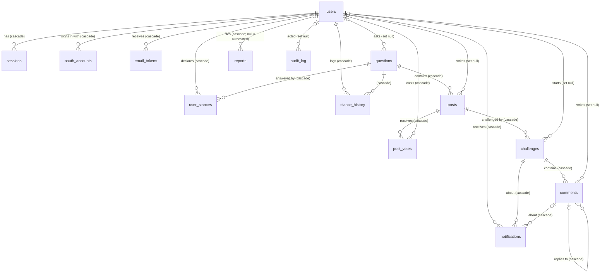
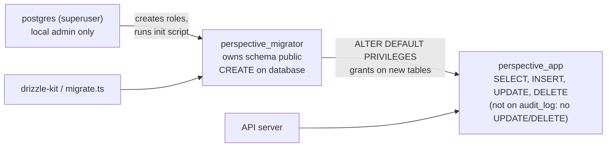

# Database Architecture

PostgreSQL 18 is the single source of truth. The schema is written in TypeScript in `apps/api/src/db/schema.ts`, turned into SQL migrations by `drizzle-kit`, and applied by Drizzle's migrator. There are **15 tables** and **11 enum types**.

New to databases? Start with [DATABASE_FUNDAMENTALS.md](../05_DATABASE/DATABASE_FUNDAMENTALS.md); every column is explained in [SCHEMA_EXPLANATION.md](../05_DATABASE/SCHEMA_EXPLANATION.md).

## Entity-relationship diagram (actual schema)

`oauth_pending` has no foreign keys: it holds a Google identity that doesn't belong to any user _yet_. `reports.target_id` and `audit_log.target_id` point at rows in several different tables, so they can't have a foreign key either (a foreign key must name one table).

## Tables by area

| Area       | Table            | Primary key                      | Purpose                                                            |
| ---------- | ---------------- | -------------------------------- | ------------------------------------------------------------------ |
| Identity   | `users`          | `id` (UUIDv7)                    | Accounts; `password_hash` null for Google-only accounts            |
|            | `sessions`       | `id`                             | Logged-in browsers; only the SHA-256 of the cookie token is stored |
|            | `oauth_accounts` | (`provider`, `provider_user_id`) | Google identities linked to users, matched by Google's `sub`       |
|            | `oauth_pending`  | `id`                             | A verified Google identity waiting for its next step (15 min)      |
|            | `email_tokens`   | `id`                             | Verify-email and reset-password links (hashed)                     |
| Content    | `questions`      | `id`                             | Questions, slugs, generated search vector, stance counts           |
|            | `user_stances`   | (`user_id`, `question_id`)       | A reader's current stance: one per person per question             |
|            | `stance_history` | `id`                             | Every declaration and change                                       |
|            | `posts`          | `id`                             | Arguments, filed under the author's stance; scores precomputed     |
|            | `post_votes`     | (`user_id`, `post_id`)           | "Helped me understand", with the voter's stance and weight frozen  |
| Debate     | `challenges`     | `id`                             | A challenge to one post                                            |
|            | `comments`       | `id`                             | Threaded replies (adjacency list via `parent_id`), `depth` stored  |
|            | `notifications`  | `id`                             | "Your post was challenged", "someone replied"                      |
| Moderation | `reports`        | `id`                             | One report per person per item; automated reports have no reporter |
|            | `audit_log`      | `id`                             | Every moderator action; append-only at the database level          |

## Design principles visible in the schema

1. **UUIDv7 primary keys generated by Postgres** (`default uuidv7()`, D26). They can't be enumerated like `/users/1042`, and they sort by creation time, so "newest first" is just `order by id desc` (D38).
2. **The database enforces the rules too**, not only the API:
   - Case-insensitive uniqueness via unique indexes on `lower(email)` and `lower(username)` (D28).
   - `check` constraints on username format, title and body lengths, comment depth (1–50) and non-negative stance counts.
   - Partial unique index: one _live_ post per author per side (`where deleted_at is null`).
   - Composite primary keys make "one stance per person per question" and "one vote per person per post" impossible to break.
3. **Soft deletes and moderator removal are separate columns** (`deleted_at` vs `removed_at`, or a `status` enum), so a mistaken removal can be undone, and authors can't dodge a removal by re-posting (D15, D50).
4. **Content outlives its author** (`on delete set null` on author columns). Personal data, by contrast, is deleted with the user (`on delete cascade` on sessions, stances, votes, notifications).
5. **Derived values are stored and maintained transactionally:** `posts.helpful_score/helpful_count/cross_side_count` and `questions.for_count/neutral_count/against_count`.
6. **Indexes are shaped exactly like the queries that use them**, including partial-index conditions and sort direction (D66, D74). See [INDEXING_AND_QUERY_OPTIMIZATION.md](../05_DATABASE/INDEXING_AND_QUERY_OPTIMIZATION.md).
7. **Least-privilege roles** (D19): the app connects as `perspective_app` (rows only), and migrations run as `perspective_migrator` (owns the schema). The app role can't even modify `audit_log` rows (D52).

## Roles and permissions

- Locally the roles are created by `docker/postgres/init/01-roles.sh` on the first start of an empty volume.
- On Neon (no superuser) they are created by `pnpm db:setup-roles` (`apps/api/scripts/setup-roles.ts`, D62), which also needs `grant perspective_migrator to current_user` so the owner account can hand the schema over.
- The production container runs migrations as the migrator, then **removes** `MIGRATION_DATABASE_URL` from the server's environment before starting it (`env -u` in the Dockerfile CMD, D57). The running server never holds credentials that could change the schema.

## Databases (local Docker)

| Database           | Used by                                |
| ------------------ | -------------------------------------- |
| `perspective`      | development                            |
| `perspective_test` | API integration tests and E2E tests    |
| `perspective_load` | Phase 9 load lab (~4.4 M rows, 1.4 GB) |

All three get the same role setup from the init script.

## Migrations

13 migrations (`0000`–`0012`), all generated by `drizzle-kit generate` except:

- `0004_enable_pg_trgm.sql` (hand-written: enables the trigram extension),
- an appended `REVOKE UPDATE, DELETE, TRUNCATE ON "audit_log" FROM perspective_app;` in `0009`,
- an appended backfill `UPDATE` in `0011`.

Each is explained in [MIGRATIONS_EXPLAINED.md](../05_DATABASE/MIGRATIONS_EXPLAINED.md).
