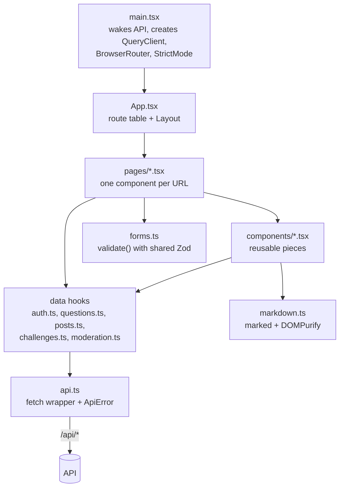

# Frontend Architecture

The website (`apps/web`) is a **single-page application (SPA)**: the server sends one HTML page and one JavaScript bundle, and from then on React draws every page in the browser. Clicking a link changes the URL and swaps components without reloading the page.

## Layers



| Layer      | Files                                                                   | Responsibility                                                             |
| ---------- | ----------------------------------------------------------------------- | -------------------------------------------------------------------------- |
| Entry      | `main.tsx`                                                              | Start the wake-up ping, set up providers, mount React into `#root`         |
| Routing    | `App.tsx`                                                               | Map URLs to pages; wrap pages in the site layout; guard members-only pages |
| Pages      | `pages/*.tsx` (19 files)                                                | One screen each; combine hooks and components                              |
| Components | `components/*.tsx` (15 files)                                           | Reusable UI: header, cards, columns, buttons, forms, thread                |
| Data hooks | `auth.ts`, `questions.ts`, `posts.ts`, `challenges.ts`, `moderation.ts` | All server communication, wrapped in TanStack Query                        |
| HTTP       | `api.ts`                                                                | One `api<T>()` function used by every hook                                 |
| Helpers    | `forms.ts`, `markdown.ts`, `title.ts`                                   | Form validation, safe Markdown, page titles                                |
| Styles     | `styles.css` (one file, ~2,250 lines)                                   | Design tokens (`--bg`, `--accent`, `--for`...), layout, components         |

## State: three kinds, three homes

A frontend has to keep track of different kinds of "state" (data that can change). Perspective keeps each kind in a different place:

| Kind of state                                                | Example                                                           | Where it lives                                            |
| ------------------------------------------------------------ | ----------------------------------------------------------------- | --------------------------------------------------------- |
| **Server state**: a copy of data the API owns                | the current user, a question, a column of posts                   | **TanStack Query cache** (keys like `["question", slug]`) |
| **URL state**: what should survive a reload or a shared link | the sort order, a search query, the moderation tab                | **The URL query string** (`useSearchParams`)              |
| **Local UI state**: only this component cares                | form inputs, "is the report form open?", which phone tab is shown | **`useState`** in the component                           |

**Why no Redux or global store?** Almost all "global" data in this app is really server data. TanStack Query already caches it, shares it between components that use the same key, refetches it when needed, and tracks loading and error states. A separate store would duplicate that cache and could drift out of sync with it.

### Query keys used

| Key                                                                   | Hook                          | Invalidated / updated by                                        |
| --------------------------------------------------------------------- | ----------------------------- | --------------------------------------------------------------- |
| `["me"]`                                                              | `useCurrentUser`              | login, register, logout, Google completion, reset, email verify |
| `["providers"]`                                                       | `useProviders` (never stale)  | none                                                            |
| `["questions", "list", sort]`                                         | `useQuestionList`             | `useAskQuestion` invalidates `["questions"]`                    |
| `["questions", "featured"]`                                           | `useFeaturedQuestions`        | same                                                            |
| `["questions", "search", q]`, `["questions", "similar", t]`           | search / similar              | same                                                            |
| `["question", slug]`                                                  | `useQuestion`                 | set directly after asking                                       |
| `["stance", slug]`                                                    | `useMyStance`                 | set directly by `useSetStance`                                  |
| `["posts", slug, stance, sort]`                                       | `useColumn` (infinite)        | write/edit/delete invalidate; **votes patch in place**          |
| `["post", id]`                                                        | `usePost`                     | edit sets it; votes patch it                                    |
| `["challenges", postId]`, `["challenge", id]`, `["thread", id, root]` | challenge hooks               | create/reply/delete invalidate                                  |
| `["notifications", "unread"]`                                         | `useUnreadCount` (polls 60 s) | mark-read sets it to 0                                          |
| `["moderation", ...]`                                                 | queue / audit                 | every moderation action invalidates `["moderation"]`            |

**Why votes patch the cache instead of refetching** (`posts.ts:99`): if the column were refetched after a vote, the post's new score could move it up the list, so the post the reader just clicked would jump away. Patching keeps the order and updates the numbers (D46).

## Routing and the layout

`App.tsx` defines two kinds of routes:

- `/login` and `/signup` render **outside** the site layout: they have their own split-screen `AuthLayout`.
- Everything else renders inside `Layout`: `SiteHeader` + `<main>` + `SiteFooter`. On `/` the header is laid over the artwork (`overlay`), and `<main>` drops its page padding so the hero can run edge to edge.

Members-only routes (`/account`, `/ask`, `/q/:slug/write`, `/posts/:id/edit`, `/posts/:id/challenge`, `/notifications`, `/moderation`) are nested under `<RequireAuth />`. It shows "Loading…" while `/auth/me` is pending, then either renders the page or redirects to `/login?next=<where you were>`.

> **Important security point:** `RequireAuth` and the "Moderators only" check in `ModerationPage` only decide **what to draw**. They protect nothing. The API checks the session and role on every request; a person who edits the JavaScript can see an empty page, but can't get data. The comments in `RequireAuth.tsx:4` and `ModerationPage.tsx` say exactly this.

`safeRedirect` (`auth.ts:153`) only follows `next` values that start with `/` but not `//`. That stops an **open redirect**: a link like `/login?next=https://evil.example` (or `//evil.example`, which browsers treat as another site) can't send people elsewhere after they log in.

## Talking to the API: `api.ts`

```ts
export async function api<T>(
  path: string,
  options: { method?: string; body?: unknown } = {},
): Promise<T>;
```

- Prefixes `/api`, sets `Content-Type: application/json` only when there is a body, and stringifies the body.
- `204 No Content` returns `undefined`.
- Any non-2xx response becomes an `ApiError` with `status`, `code` and `details`, parsed from the API's standard error shape. If the body isn't JSON, a generic `INTERNAL_ERROR` is used.
- **502 retry (D64):** if a `VITE_API_WAKE_URL` is configured and the response is 502, it pings the wake URL and retries every 3 s for up to 2 minutes. Only 502 is retried, because it means the request never reached the API, so nothing can run twice. See [API_WAKE_UP.md](../04_FEATURE_DEEP_DIVES/API_WAKE_UP.md).

Cookies need no code: the request goes to the same origin, so the browser attaches the `session` cookie automatically.

## Forms: validate twice, with the same rules

Every form follows the same pattern (e.g. `LoginPage.tsx:42`):

1. `validate(schema, values)` (`forms.ts:7`) runs the **shared Zod schema** in the browser. Errors are shown under each field with no network request.
2. If it passes, the mutation sends the _parsed_ data (trimmed, lowercased email, etc.).
3. If the API still refuses, `errorsFromApi` (`forms.ts:28`) maps `details[]` to fields, maps `EMAIL_TAKEN`/`USERNAME_TAKEN` to their field, and otherwise shows one form-level message.

**Why validate in the browser if the API validates anyway?** For speed and friendliness only. The browser check can be skipped by anyone, so the API check is the one that counts. Sharing the schema means the two can never disagree (e.g. the browser accepting a username the API rejects).

## Rendering user content safely

User-written Markdown (posts, challenges, comments) is converted by `renderMarkdown` (`markdown.ts:32`): `marked` makes HTML, then **DOMPurify** strips everything outside a small allowlist. Only then is it inserted with `dangerouslySetInnerHTML`. Every other piece of user text (titles, usernames) is rendered as normal JSX text, which React escapes automatically. See [CSRF_CORS_AND_XSS.md](../07_SECURITY/CSRF_CORS_AND_XSS.md).

## Design system

`styles.css` starts with **design tokens** on `:root` (D55): `--bg #f1efe7` (cream), `--surface #fbfaf6`, `--accent #9b301e` (brick red), `--for`, `--neutral`, `--against` with darker `*-text` variants for readable text, and `--container 1240px`. Colours were sampled from the front-page artwork. One light theme only. The fonts are Open Sauce One, self-hosted through Fontsource (no request to Google Fonts).

The landing-page hero is sized in `vw` and container-query units, so the artwork and heading scale together. It switches to a stacked layout at 1100 px wide and to a phone layout at 760 px. That was the last commit (`cdd117f`), explained in [BUGS_AND_FIXES.md](../08_BUGS_AND_DEBUGGING/BUGS_AND_FIXES.md).

## Build and output

`vite build` writes `apps/web/dist`: `index.html` plus hashed files in `dist/assets/` (e.g. `index-3f9a1c.js`). Because the hash changes whenever the content changes, assets can be cached forever (`Cache-Control: public, max-age=31536000, immutable` in `vercel.json` and nginx). `index.html` itself is `no-cache`, so a new deploy is picked up immediately.

All page paths are rewritten to `index.html` (`vercel.json` `rewrites`, nginx `try_files $uri /index.html`). Without that, reloading `/q/some-question` would ask the server for a file that doesn't exist and get a 404.

File-by-file guide: [FRONTEND_FILE_GUIDE.md](../02_CODEBASE/FRONTEND_FILE_GUIDE.md).
