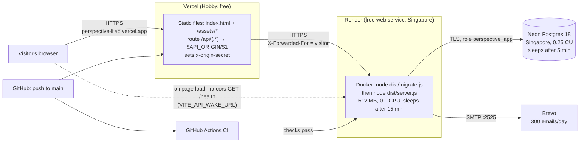

# Infrastructure and Deployment

This page describes **what actually runs in production** and the two local Docker setups. The load-testing lab is described separately in [SCALING_AND_INFRASTRUCTURE_EXPERIMENTS.md](../09_TESTING_AND_DEPLOYMENT/SCALING_AND_INFRASTRUCTURE_EXPERIMENTS.md). Step-by-step setup is in [DEPLOYMENT_GUIDE.md](../09_TESTING_AND_DEPLOYMENT/DEPLOYMENT_GUIDE.md) and `docs/DEPLOYMENT.md`.

## Production topology (FACT, checked live)



### How a deploy happens

1. A commit is pushed to `main` on GitHub.
2. **GitHub Actions** runs CI (`.github/workflows/ci.yml`): format, typecheck, lint, `pnpm audit --audit-level high`, unit and API tests against a real Postgres, web build, Playwright E2E, and both Docker builds.
3. **Render** has `autoDeployTrigger: checksPass` (`render.yaml`), so it builds and deploys the API image **only if CI passed**.
4. **Vercel** builds the website from `apps/web` (Root Directory) on every push.
5. When the API container starts:
   ```sh
   node dist/migrate.js && exec env -u MIGRATION_DATABASE_URL node dist/server.js
   ```
   Migrations run first, under a Postgres advisory lock. Then the server starts **without** the migrator's credentials in its environment (D57). `exec` replaces the shell with Node, so Node receives `SIGTERM` directly and can shut down gracefully.

### The proxy and the secret (D61)

The Render URL is public. Without protection, anyone could call it directly and put any address in `X-Forwarded-For`. The API would then rate-limit the fake address, and attackers could dodge every limit. So:

- Vercel adds `x-origin-secret: <ORIGIN_SECRET>` to every proxied request (`vercel.json` `transforms`). Vercel also **overwrites** `X-Forwarded-For` with the real visitor address.
- The API refuses every request without the right secret, except `/health` and `/health/ready`, which Render's health checks call directly (`plugins/proxy-secret.ts`).
- Because every accepted request provably came through Vercel, the API can trust `X-Forwarded-For` (`trustProxy: true` when `ORIGIN_SECRET` is set, `app.ts:39`).
- The secret is compared with `timingSafeEqual` after hashing both sides to equal length. A normal `===` returns at the first differing character, and that timing difference can leak the secret byte by byte.

### Environment variables in production

| Where  | Variable                                           | Purpose                                                                |
| ------ | -------------------------------------------------- | ---------------------------------------------------------------------- |
| Render | `WEB_ORIGIN`                                       | `https://perspective-lilac.vercel.app`: CSRF origin, CORS, email links |
| Render | `DATABASE_URL`                                     | Neon, as `perspective_app`                                             |
| Render | `MIGRATION_DATABASE_URL`                           | Neon, as `perspective_migrator` (removed before the server starts)     |
| Render | `ORIGIN_SECRET`                                    | ≥32 chars, shared with Vercel                                          |
| Render | `SMTP_URL`, `EMAIL_FROM`                           | Brevo on port 2525                                                     |
| Render | `GOOGLE_*`                                         | left empty: Google sign-in off                                         |
| Image  | `NODE_ENV=production`, `HOST=0.0.0.0`, `PORT=3000` | from the Dockerfile; Render injects its own `PORT`                     |
| Vercel | `API_ORIGIN`                                       | the Render URL (used in the route `dest`)                              |
| Vercel | `ORIGIN_SECRET`                                    | the same secret                                                        |
| Vercel | `VITE_API_WAKE_URL`                                | Render URL + `/health`, compiled into the JS bundle                    |
| Vercel | `ENABLE_EXPERIMENTAL_COREPACK=1`                   | makes Vercel use the pinned pnpm 12                                    |

Secrets are typed into the Render and Vercel dashboards. `render.yaml` lists them with `sync: false` (no values in git). `API_ORIGIN` and `ORIGIN_SECRET` are scoped to **Production only** on Vercel, so preview deployments of branches can't reach the real API.

`VITE_` variables are compiled into public JavaScript. That's fine for the wake URL (it's public anyway) and would be a leak for a secret. Vercel shows a warning about this prefix, which the owner saw during setup; it is expected for this variable.

## The API image (`apps/api/Dockerfile`)

A **multi-stage build**: the first stage has all the tools, and the final image keeps only what runs.

| Stage | Steps                                                                                                                      | Why                                                                                        |
| ----- | -------------------------------------------------------------------------------------------------------------------------- | ------------------------------------------------------------------------------------------ |
| build | `node:22-alpine`, `corepack enable` (gets pinned pnpm)                                                                     |                                                                                            |
|       | Copy only `package.json` files + lockfile, then `pnpm install --frozen-lockfile --filter @perspective/api...`              | Docker caches this layer: dependencies reinstall only when a manifest changes              |
|       | Copy `packages/shared` and `apps/api`, then `pnpm --filter @perspective/api build` (esbuild) and `pnpm deploy --prod /out` | `deploy --prod` produces a standalone folder with production deps only                     |
| final | `node:22-alpine`, `ENV NODE_ENV=production HOST=0.0.0.0 PORT=3000`                                                         | `0.0.0.0` = listen on all interfaces (inside a container `127.0.0.1` would be unreachable) |
|       | Copy `package.json`, `node_modules`, `dist`, `migrations`                                                                  | No TypeScript, tsx, drizzle-kit or vitest in production                                    |
|       | `USER node`                                                                                                                | Not root: a compromised process has fewer powers                                           |
|       | `HEALTHCHECK CMD wget -qO- http://127.0.0.1:${PORT}/health`                                                                | Docker can see if the process is alive                                                     |
|       | `CMD sh -c "node dist/migrate.js && exec env -u MIGRATION_DATABASE_URL node dist/server.js"`                               | Migrate, then serve without migrator credentials                                           |

`--frozen-lockfile` fails the build if `pnpm-lock.yaml` doesn't match the manifests, so production installs exactly what was tested.

## The web image (`apps/web/Dockerfile`)

Used for the local "production-like" setup (`--profile app`) and built in CI. **Production uses Vercel instead**, which builds the same `vite build` output itself.

- Build stage: install, `pnpm --filter @perspective/web build`.
- Final stage: `nginxinc/nginx-unprivileged` (runs as non-root, which is why it listens on 8080), the template config proxies `/api/` to `${API_UPSTREAM}` (default `http://api:3000`), gzip is on, `/assets/` are cached for a year, and everything else gets `try_files $uri /index.html`.

## Local Docker Compose profiles

| Command                                       | Starts                                                                                                       |
| --------------------------------------------- | ------------------------------------------------------------------------------------------------------------ |
| `docker compose up -d`                        | `postgres` (18, with `pg_stat_statements`) and `redis` (8.2, 256 MB, `volatile-lru`, no persistence)         |
| `docker compose --profile app up -d --build`  | + `api`, `worker`, `web` (:4173) and `mailpit` (:8025, a fake inbox)                                         |
| `docker compose --profile load up -d --build` | + `api-load` (1 CPU, 512 MB), `postgres-replica`, `lb-load` (nginx), `prometheus`, `jaeger`, `grafana`, `k6` |

All host ports are bound to `127.0.0.1`, so they're reachable only from the developer's own machine, not from the local network.

Redis runs with `--maxmemory-policy volatile-lru`: when memory is full, Redis evicts only keys **with an expiry**. Cached pages have expiries; the version counters (`version:*`) don't, so they're never evicted. See [SCALING_AND_INFRASTRUCTURE_EXPERIMENTS.md](../09_TESTING_AND_DEPLOYMENT/SCALING_AND_INFRASTRUCTURE_EXPERIMENTS.md).

## Free-tier limits that shape behaviour (October 2026)

| Service | Limit                                                      | Consequence for Perspective                                                       |
| ------- | ---------------------------------------------------------- | --------------------------------------------------------------------------------- |
| Render  | Sleeps after 15 idle minutes; ~30–60 s to wake             | First visit after a quiet period is slow; handled by the wake-up ping + 502 retry |
| Render  | 0.1 CPU, 512 MB                                            | argon2 hashing is slower; one instance only                                       |
| Render  | Outbound ports 25/465/587 blocked                          | Brevo on 2525                                                                     |
| Neon    | Sleeps after 5 idle minutes; 100 CU-hours/month at 0.25 CU | First query after idle is slower; plenty of hours for a demo                      |
| Neon    | Restore only within the last 6 hours                       | **No real backups yet** (open item)                                               |
| Vercel  | Hobby = non-commercial use; 10 GB origin transfer/month    | Fine for a portfolio project                                                      |
| Brevo   | 300 emails/day; sender is a personal address               | Mail may land in spam until a custom domain is authenticated                      |
