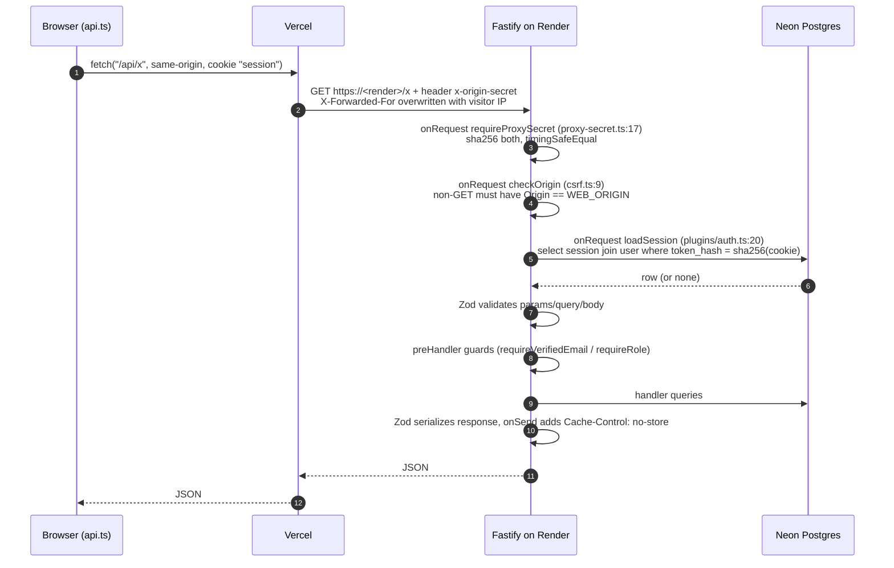

# Request–Response Flows

Each flow below follows one user action from the click, through the frontend hook, the network, every API hook, the handler and the SQL, and back to the screen. File references are `path:line` at commit `cdd117f`.

The flows assume **production** (Vercel → Render → Neon, no Redis). Where the lab (Redis) changes something, it is noted.

---

## Flow 0: what every request goes through



If Render is asleep, step 2 returns **502** immediately; `api.ts:32` pings `VITE_API_WAKE_URL` directly and retries every 3 s (see [API_WAKE_UP.md](../04_FEATURE_DEEP_DIVES/API_WAKE_UP.md)).

---

## Flow 1: Logging in

**User action:** types email and password on `/login` and presses "Log in".

1. **Browser validation.** `LoginPage.tsx:42` calls `validate(loginSchema, values)`. `loginSchema` (`packages/shared/src/users.ts:42`) trims and lowercases the email and requires a non-empty password (≤128). On failure, field errors are shown and nothing is sent.
2. **Mutation.** `useLogin()` (`auth.ts:32`) runs `api("/auth/login", { method: "POST", body })`. The body is JSON, so the browser adds `Content-Type: application/json`, and as a POST it also adds `Origin: https://perspective-lilac.vercel.app`.
3. **Hooks.** The proxy secret passes; `checkOrigin` passes because `Origin` equals `WEB_ORIGIN`; `loadSession` finds no cookie, or an old one.
4. **Rate limit.** The route's `config: rateLimit(10, 15)` (`auth/routes.ts:58`) allows 10 attempts per 15 minutes per IP. In production this is counted in memory; in the lab, in Redis.
5. **Validation.** Fastify runs `loginSchema` again on the server. This is the check that counts.
6. **Handler** (`auth/routes.ts:61`):
   ```sql
   select id, username, email, role, ..., exists(select 1 from oauth_accounts ...) as google_connected, password_hash
   from users where lower(email) = $1
   ```
   - No user, or a Google-only user with no password → `verifyAgainstDummy(password)` runs a full argon2 verification against a dummy hash, so the response takes as long as a real wrong password. Then 401 `INVALID_CREDENTIALS`.
   - Wrong password → the same 401 with the same message.
   - Banned → 403 "This account has been suspended". This is only reachable with the correct password, so it doesn't reveal account existence.
7. **Pending Google link.** `linkPendingGoogle` (`auth/oauth.ts:72`) checks for a `google_pending` cookie. If one exists and its email matches this account, the Google identity is linked (D27). Otherwise nothing happens.
8. **Session.** `startSession` (`auth/sessions.ts:93`) deletes any session the browser already had (session-fixation defence), generates 32 random bytes as the token, and inserts `sessions(user_id, token_hash = sha256(token), expires_at = now+30d, ip, user_agent)`. Then `Set-Cookie: session=<token>; HttpOnly; Secure; SameSite=Lax; Path=/; Expires=...`.
9. **Response.** `{ user: PublicUser }` (no password hash: the response schema only has the public fields).
10. **Frontend.** `onSuccess` puts the user into the query cache under `["me"]` (no refetch needed). `LoginPage` navigates to `safeRedirect(next)`, which defaults to `/account`.

**Tables touched:** `users` (read), `oauth_pending`/`oauth_accounts` (maybe), `sessions` (delete + insert).

---

## Flow 2: Opening a question page

**User action:** clicks a question card, so the browser shows `/q/should-cities-ban-cars-downtown`.

The page fires these requests in parallel:

| Hook                                    | Request                                                    | Purpose                      |
| --------------------------------------- | ---------------------------------------------------------- | ---------------------------- |
| `useQuestion(slug)` (`questions.ts:75`) | `GET /api/questions/should-cities-ban-cars-downtown`       | title, description, counts   |
| `useCurrentUser()`                      | `GET /api/auth/me` (usually already cached)                | who is viewing               |
| `useMyStance(slug, loggedIn)`           | `GET /api/questions/:slug/stance` (only when logged in)    | the reader's side + cooldown |
| `useColumn(slug, "for", sort)` ×3       | `GET /api/questions/:slug/posts?stance=for&sort=top`, etc. | the three columns            |

**`GET /questions/:slug`** (`questions/routes.ts:269`):

```sql
select q.id, q.slug, q.title, q.description, q.created_at, u.username,
       q.for_count, q.neutral_count, q.against_count,
       (select count(*) from posts p where p.question_id = q.id
          and p.deleted_at is null and p.removed_at is null)::int as post_count
from questions q left join users u on u.id = q.created_by
where q.status = 'published' and q.slug = $1
```

The `slug` lookup uses the unique index `questions_slug_unique`; the post count uses the partial index `posts_column_idx`.

**`GET /questions/:slug/posts?stance=for&sort=top`** (`posts/routes.ts:40`):

1. `findPublishedQuestionId(slug)` → 404 if the question is missing or removed.
2. `rankPosts("top", cursor)` (`posts/ranking.ts:48`) returns the `ORDER BY`, the "after the cursor" condition and the cursor encoder.
3. The query joins `posts → questions → users`, plus a **left join on `post_votes` for the viewer only**, so `votedByMe` comes back in the same query:
   ```sql
   ... left join post_votes v on v.post_id = p.id and v.user_id = $viewer   -- or "and false" when logged out
   where p.deleted_at is null and p.removed_at is null and q.status = 'published'
     and p.question_id = $1 and p.stance = 'for'
     [and (p.helpful_score, p.id) < ($rank, $id)]      -- next pages
   order by p.helpful_score desc, p.id desc
   limit 11                                             -- one extra to know if there's a next page
   ```
   The partial index `posts_column_top_idx (question_id, stance, helpful_score desc, id desc) where deleted_at is null and removed_at is null` lets Postgres read the first 11 entries in order and stop.
4. 10 posts are returned, plus `nextCursor` = base64url JSON `{ id, rank }` if an 11th existed.

**Lab difference:** for logged-out visitors, `serveFromCache` builds a key such as `cache:question:<slug>@7,moderation@2:/questions/<slug>/posts?stance=for&sort=top` and may answer from Redis without touching Postgres. See [SCALING_AND_INFRASTRUCTURE_EXPERIMENTS.md](../09_TESTING_AND_DEPLOYMENT/SCALING_AND_INFRASTRUCTURE_EXPERIMENTS.md).

**Rendering:** `QuestionPage.tsx` renders the header, `StanceSummary` (percentages), `StancePicker`, the sort bar and three `PostColumn`s. On phones a CSS rule hides two of the three columns based on `data-shown`. Each `PostCard` renders its body through `renderMarkdown` (DOMPurify).

---

## Flow 3: Taking a side

**User action:** on the question page, clicks "against", then "Confirm".

1. `StancePicker.tsx` keeps the pending choice in local state, so a click only asks for confirmation (D43: the first declaration already starts the 24-hour cooldown).
2. `useSetStance(slug).mutate("against")` → `PUT /api/questions/:slug/stance` with body `{ "stance": "against" }`.
3. Guards: there is no `preHandler`; the handler calls `requireUser`, so a logged-in user is required, but **not** a verified email. Rate limit: 30 per hour.
4. Handler (`stances/routes.ts:66`), one transaction:
   ```sql
   begin;
   select * from user_stances where user_id = $u and question_id = $q for update;   -- row lock
   -- no row: first declaration
   insert into user_stances (user_id, question_id, stance) values (...) on conflict do nothing returning *;
   insert into stance_history (user_id, question_id, to_stance) values (...);
   update questions set for_count = for_count + 0, neutral_count = neutral_count + 0,
                        against_count = against_count + 1 where id = $q;
   commit;
   ```
   If a row exists with a different stance, `updated_at` is checked: if it's less than 24 h old → 429 `STANCE_COOLDOWN`. Otherwise the row is updated, history gets `from_stance`, and the counts move (-1 on the old side, +1 on the new).
5. After the commit: `bumpCache(log, "question:<slug>")` (a no-op without Redis).
6. Response `{ stance: "against", changeableAt: "<now + 24h>" }`. `onSuccess` writes it into `["stance", slug]`; the picker now shows the locked state, and the "Write a post" button appears in the Against column.

**Why `for update`?** Two simultaneous requests (double click, two tabs) would otherwise both read "no change in 24 h" and both change the stance. The row lock makes the second wait until the first commits; it then sees the fresh `updated_at` and is refused. The test `posts.test.ts:118` ("lets only one of two simultaneous changes through") proves this. Concurrency is explained in [SQL_CONCEPTS_USED.md](../05_DATABASE/SQL_CONCEPTS_USED.md).

---

## Flow 4: Voting "Helped me understand"

**User action:** a reader who stands **For** clicks the button on an **Against** post.

1. `HelpfulButton.tsx` first checks `blockedReason` (email verified? account ≥24 h old? has a stance?) and disables the button with a hint. This is purely for user experience; the API checks all of it again.
2. `useVote(slug).mutate({ postId, voted: true })` → `PUT /api/posts/:id/vote` (no body).
3. Guards: `requireVerifiedEmail`; rate limit 120/hour.
4. Handler (`votes/routes.ts:31`):
   - account age < 24 h → 403 `ACCOUNT_TOO_NEW` (D45)
   - `findPost` → 404 if deleted, removed, or on an unpublished question
   - own post → 403 `OWN_POST`
   - no stance on this question → 409 `STANCE_REQUIRED` (D6)
   - `weight = voteWeight("for", "against") = 3`, `crossSide = 1`
   - transaction:
     ```sql
     insert into post_votes (user_id, post_id, voter_stance, weight) values ($u, $p, 'for', 3)
       on conflict do nothing returning weight;
     -- only if a row was inserted:
     update posts set helpful_score = helpful_score + 3, helpful_count = helpful_count + 1,
                      cross_side_count = cross_side_count + 1 where id = $p
       returning helpful_score, helpful_count, cross_side_count;
     ```
     A repeated vote hits the primary key `(user_id, post_id)`, inserts nothing, and just reads the counts, so double-clicking can't double-count.
5. After commit: `bumpCache(..., "question:<slug>")`.
6. Response `{ helpfulScore, helpfulCount, crossSideCount, votedByMe: true }`.
7. `onSuccess` **patches** the post in `["post", id]` and in every cached page of `["posts", slug, ...]` without refetching, so the column doesn't reshuffle.

**Unvote** (`DELETE`) deletes the row `returning weight, voter_stance` and subtracts **exactly what was stored**, even if the voter has since changed sides (D7).

---

## Flow 5: Challenging a post and getting notified

1. `NewChallengePage` → `useCreateChallenge(postId)` → `POST /api/posts/:id/challenges` `{ title, body }`.
2. Guards: `requireVerifiedEmail`. Checks: own post → 403; 5 challenges in the last day → 429 (counted in Postgres).
3. Transaction (`challenges/routes.ts:133`):
   1. `insert into challenges ... returning id`. The unique index `(created_by, post_id)` makes a second challenge fail with `challenges_creator_post_unique` → 409 `ALREADY_CHALLENGED`.
   2. `rejectDuplicate`: the same normalized text by the same author in the last day → 409 `DUPLICATE_CONTENT`, and the whole transaction rolls back.
   3. `flagIfSuspicious`: if there are ≥3 links and the account is <3 days old, an automated `reports` row is inserted (the challenge stays published).
   4. `notify(tx, { userId: post.authorId, actorId: user.id, type: "post_challenged", challengeId })`, skipped if the author's account was deleted or the author is the challenger.
4. After commit: `bumpCache("question:<slug>")`, because columns show challenge counts.
5. The response is the full challenge page payload; the browser navigates to `/c/:id`.
6. **The post's author** has a header that polls `GET /notifications/unread-count` every 60 s (`challenges.ts:85`). The count uses the partial index `notifications_unread_idx (user_id) where read_at is null`. On their next poll the badge shows 1.

---

## Flow 6: A moderator removes a post

1. `ModerationPage` → `useModerate()` → `POST /api/moderation/post/:id/remove` `{ reason }`.
2. The whole moderation scope has `preHandler: requireRole("moderator")` (`moderation/routes.ts:108`). The role is read from the database on every request via `loadSession` (D36), so a demotion applies immediately.
3. `findTarget("post", id)` → 404 if it doesn't exist.
4. Transaction: `update posts set removed_at = now()`; `update reports set status='resolved', resolved_by, resolved_at where target = ... and status='open'`; `insert into audit_log (actor_id, action='remove', target_type, target_id, reason)`.
5. `bumpCache("moderation")`: in the lab this invalidates every cached page, because removals are rare and can affect lists, columns and counts.
6. The post now fails the `live` filter (`posts/queries.ts:84`) everywhere: columns, the post page, votes, challenges.

---

## Flow 7: Signing up and verifying an email (production, no Redis)

1. `POST /auth/register` (5/hour/IP): `insertUser` with an argon2id hash → 409 on a duplicate email or username (D31) → `startSession` → `sendVerificationEmail`.
2. `issueToken(userId, "verify_email")`: in one transaction, delete older verify tokens and insert a new hashed one (24 h).
3. `sendEmail` → no queue in production → `deliverEmail` → nodemailer SMTP to Brevo :2525. **If Brevo fails, signup still succeeds** (the error is logged, `auth/routes.ts:46`); the user can press "Send the verification link again" on `/account`.
4. The email contains `https://perspective-lilac.vercel.app/verify-email?token=<43 chars>`.
5. Opening it renders `VerifyEmailPage`, whose `useVerifyEmail(token)` query **POSTs** the token. The link itself doesn't verify anything; this stops email scanners that "click" links from using them up (D35).
6. `consumeToken` runs `delete from email_tokens where token_hash = $1 and purpose = 'verify_email' and expires_at > now() returning user_id`, a single statement, so two simultaneous clicks can't both succeed. Then `update users set email_verified_at = coalesce(email_verified_at, now())`.

**Lab difference:** with Redis, step 3 becomes "add a job to BullMQ" and returns immediately; `worker.ts` sends it with 8 retries.
