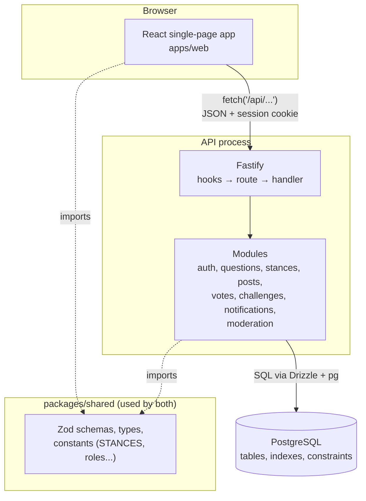
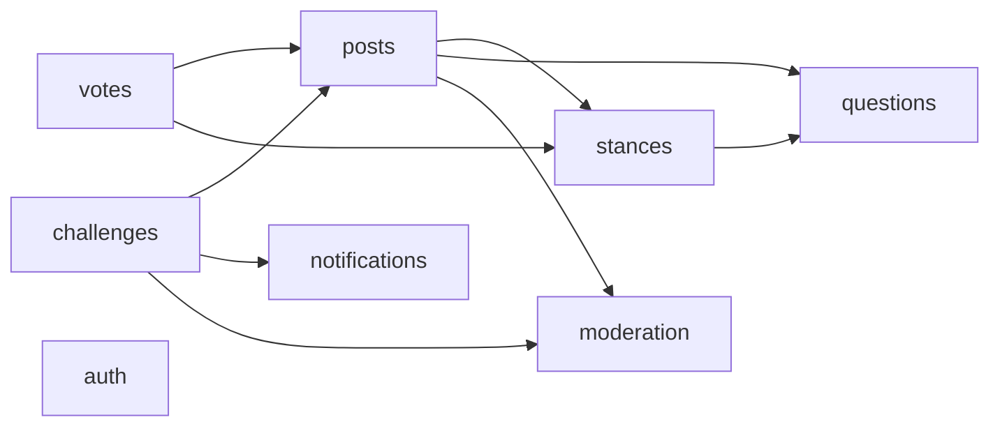
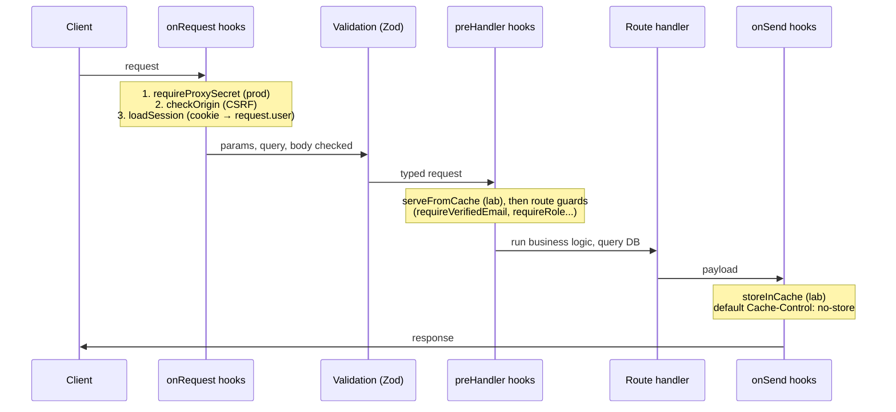

# System Architecture

## The big picture

Perspective is three programs plus shared code:

| Part     | Job                                                                                      | Trusts the others?                                                |
| -------- | ---------------------------------------------------------------------------------------- | ----------------------------------------------------------------- |
| Website  | Draws pages, collects input, shows errors early                                          | It only _displays_ rules; the API is the authority                |
| API      | Checks identity, permissions and input; runs business logic; writes data in transactions | Trusts nothing from the browser; validates every request with Zod |
| Database | Stores data; enforces uniqueness, formats, lengths, relationships                        | Last line of defence: refuses bad data even if the API has a bug  |
| Shared   | One copy of validation rules and response types                                          | n/a: it's a library compiled into both                            |

## Architectural style: a modular monolith

**FACT:** the API is one process (one Fastify app) split into feature folders under `apps/api/src/modules/`. Each module owns its routes, its validation (via shared schemas) and its queries.

**Why (D13):** "Modular monolith first, split services only when measurements demand it." A monolith is one deployable program. _Modular_ means the code is organised so each feature could be pulled out later. Microservices (many small services talking over the network) bring network failures, distributed transactions and deployment complexity. They solve problems of large teams and very uneven scaling that this project doesn't have. Phase 9 then _measured_ where the bottlenecks were (API CPU, then database reads). None of them called for splitting the code. They called for running more copies of the same monolith and adding a read replica.

What modules may do to each other:

(Arrows mean "imports a helper from". For example `votes/routes.ts` imports `findPost` from `posts/queries.ts` and `findStance` from `stances/routes.ts`.)

## The one-origin rule

**FACT:** in every environment the browser talks to **one origin** only, and `/api/*` is forwarded to the API:

| Environment             | Who serves the page              | Who forwards `/api/*`           | Config                                 |
| ----------------------- | -------------------------------- | ------------------------------- | -------------------------------------- |
| Development             | Vite dev server :5173            | Vite proxy                      | `apps/web/vite.config.ts`              |
| Local production images | nginx in the web container :4173 | nginx `proxy_pass`              | `apps/web/nginx/default.conf.template` |
| Live site               | Vercel                           | Vercel route + header transform | `apps/web/vercel.json`                 |
| End-to-end tests        | Vite :5174                       | Vite proxy → API :3100          | `e2e/playwright.config.ts`             |

In each case the prefix is stripped: `/api/questions` arrives at the API as `/questions`.

**Why (D33, D56):**

- The session cookie is **first-party**: the page and the API share a site, so browsers that block third-party cookies still send it.
- No cross-origin requests happen, so there are no CORS preflights to slow things down. The API still configures CORS strictly, in case the setup ever changes.
- The same frontend code (`fetch('/api' + path)`) works in every environment with no configuration.

## Request lifecycle inside the API

Every request passes through the same sequence of Fastify **hooks** (functions that run at fixed points in a request's life), registered in `apps/api/src/app.ts`:

If anything throws, Fastify skips ahead to the central error handler (`plugins/error-handler.ts`), which turns the error into the standard shape `{ error: { code, message, details? } }` (D22). See [BACKEND_ARCHITECTURE.md](BACKEND_ARCHITECTURE.md).

## Data ownership and consistency

- **Postgres is the single source of truth.** Everything else (the TanStack Query cache in the browser, the Redis cache in the lab, the read replica) is a copy that may be briefly stale.
- **Derived numbers are stored, not recounted:** `posts.helpful_score`, `helpful_count`, `cross_side_count` and `questions.for_count / neutral_count / against_count`. Each is updated **in the same transaction** as the action that changes it (vote, stance), so it can never drift from the rows it summarises. This is a classic _denormalisation for read performance_. See [DATABASE_DESIGN_TRADEOFFS.md](../05_DATABASE/DATABASE_DESIGN_TRADEOFFS.md).
- **Side effects that must be atomic stay in the transaction** (notifications, score updates, audit-log rows). **Side effects that can fail independently** (sending email) are allowed to happen outside it, and are queued with retries when Redis exists (D70).

## Environments

| Environment             | Database                        | Redis    | How it starts                                                  |
| ----------------------- | ------------------------------- | -------- | -------------------------------------------------------------- |
| Development             | `perspective` (Docker)          | optional | `docker compose up -d`, `pnpm dev:api`, `pnpm dev:web`         |
| API tests               | `perspective_test`              | db 1     | `pnpm test` (Vitest rewrites the URLs, `apps/api/test/env.ts`) |
| E2E tests               | `perspective_test`              | none     | `pnpm test:e2e` (Playwright starts API :3100 and Vite :5174)   |
| Local production images | `perspective` (Docker)          | yes      | `docker compose --profile app up -d --build`                   |
| Load lab                | `perspective_load` (4.4 M rows) | yes      | `docker compose --profile load up -d --build`                  |
| Production              | Neon                            | none     | Render builds `apps/api/Dockerfile`; Vercel builds `apps/web`  |

## Where to go next

- How the website is organised: [FRONTEND_ARCHITECTURE.md](FRONTEND_ARCHITECTURE.md)
- How the API is organised: [BACKEND_ARCHITECTURE.md](BACKEND_ARCHITECTURE.md)
- Tables and relationships: [DATABASE_ARCHITECTURE.md](DATABASE_ARCHITECTURE.md)
- Click-to-database traces: [REQUEST_RESPONSE_FLOWS.md](REQUEST_RESPONSE_FLOWS.md)
- Hosting: [INFRASTRUCTURE_AND_DEPLOYMENT.md](INFRASTRUCTURE_AND_DEPLOYMENT.md)
