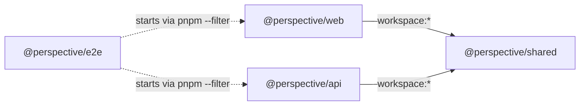

# Complete Folder Structure

All 219 tracked files at commit `cdd117f`, grouped and annotated. Generated folders (`node_modules/`, `dist/`, `coverage/`, Playwright reports) and the gitignored `.env`, `load/data/`, `load/results/` are not tracked.

```
PERSPECTIVE/
├── .github/
│   ├── workflows/ci.yml          CI: format, typecheck, lint, audit, tests, build, e2e, Docker builds
│   └── dependabot.yml            weekly grouped dependency PRs (npm, actions, docker)
├── apps/
│   ├── api/                      ── the backend (Fastify) ──
│   │   ├── Dockerfile            multi-stage production image
│   │   ├── drizzle.config.ts     drizzle-kit settings (uses MIGRATION_DATABASE_URL)
│   │   ├── package.json          deps + scripts (dev, build, db:*, seed, set-role...)
│   │   ├── tsconfig.json         extends base, adds Node types
│   │   ├── vitest.config.ts      global setup (migrate test DB), one file at a time
│   │   ├── migrations/           0000–0012 *.sql + meta/ snapshots + _journal.json
│   │   ├── scripts/
│   │   │   ├── build.ts          esbuild bundle → dist/{server,migrate,worker,instrumentation}.js
│   │   │   ├── seed.ts           realistic sample data (pnpm seed)
│   │   │   ├── setup-roles.ts    create the two roles on a hosted DB (Neon)
│   │   │   ├── set-role.ts       pnpm set-role <email> <role>
│   │   │   ├── recompute-scores.ts  rebuild vote weights + post scores
│   │   │   ├── load-fixtures.ts  load-test targets + 2,000 sessions (lab)
│   │   │   └── with-load-db.ts   run a command against perspective_load
│   │   ├── src/
│   │   │   ├── server.ts         process entry: listen, error listeners, shutdown
│   │   │   ├── app.ts            buildApp(): plugins, hooks, routes
│   │   │   ├── errors.ts         AppError
│   │   │   ├── cache.ts          Redis cache, versioned scopes, replica routing (lab)
│   │   │   ├── mailer.ts         SMTP sending, optional BullMQ queue
│   │   │   ├── worker.ts         email worker process (lab)
│   │   │   ├── migrate.ts        deploy-time migrations + advisory lock
│   │   │   ├── telemetry.ts      Prometheus metrics (lab)
│   │   │   ├── instrumentation.ts OpenTelemetry tracing (lab, opt-in)
│   │   │   ├── config/
│   │   │   │   ├── env.ts        Zod-validated environment
│   │   │   │   └── logger.ts     Pino options + redaction
│   │   │   ├── db/
│   │   │   │   ├── client.ts     Pool, Drizzle, replica, Executor type
│   │   │   │   ├── schema.ts     all tables, enums, indexes, constraints
│   │   │   │   └── errors.ts     uniqueViolation()
│   │   │   ├── plugins/
│   │   │   │   ├── auth.ts       loadSession + guards
│   │   │   │   ├── csrf.ts       Origin check
│   │   │   │   ├── error-handler.ts  error contract
│   │   │   │   └── proxy-secret.ts   ORIGIN_SECRET check
│   │   │   └── modules/
│   │   │       ├── auth/         routes, email-routes, google-routes, sessions, tokens,
│   │   │       │                 passwords, users, google, oauth, email-tokens
│   │   │       ├── questions/    routes, find, slugs
│   │   │       ├── stances/      routes, counts
│   │   │       ├── posts/        routes, queries, ranking
│   │   │       ├── votes/        routes, weights, scores
│   │   │       ├── challenges/   routes, thread
│   │   │       ├── notifications/ routes, notify
│   │   │       ├── moderation/   routes, targets, spam
│   │   │       └── health/       routes
│   │   └── test/                 15 *.test.ts + env.ts, global-setup.ts, setup.ts, helpers.ts
│   └── web/                      ── the frontend (React + Vite) ──
│       ├── Dockerfile            build + unprivileged nginx
│       ├── index.html            the single HTML page (#root)
│       ├── nginx/default.conf.template  /api proxy, caching, SPA fallback
│       ├── vercel.json           /api route + secret header, asset caching, SPA rewrite
│       ├── vite.config.ts        dev server :5173, /api proxy
│       ├── vitest.config.ts      jsdom environment
│       ├── tsconfig.json / tsconfig.node.json
│       └── src/
│           ├── main.tsx          entry: wake API, QueryClient, Router, fonts, CSS
│           ├── App.tsx           routes + Layout
│           ├── api.ts            fetch wrapper, ApiError, wake + 502 retry
│           ├── auth.ts           auth hooks, safeRedirect
│           ├── questions.ts      question hooks (+ debounce)
│           ├── posts.ts          stance, column, post, vote hooks
│           ├── challenges.ts     challenge, thread, notification hooks
│           ├── moderation.ts     report, queue, audit, moderate, ban hooks
│           ├── forms.ts          validate(), errorsFromApi()
│           ├── markdown.ts       marked + DOMPurify allowlist
│           ├── title.ts          usePageTitle
│           ├── styles.css        all styles (tokens, layout, components)
│           ├── vite-env.d.ts     types for import.meta.env
│           ├── api.test.ts, markdown.test.ts
│           ├── assets/hero.svg, heading.svg
│           ├── components/       15 components (see FRONTEND_FILE_GUIDE)
│           └── pages/            19 pages (see FRONTEND_FILE_GUIDE)
├── packages/
│   └── shared/                   ── code used by both apps ──
│       ├── package.json          "exports": { ".": "./src/index.ts" } (TS source, D17)
│       ├── tsconfig.json         no DOM, no Node types
│       └── src/
│           ├── index.ts          re-exports everything
│           ├── errors.ts         ErrorCode union, ErrorResponse
│           ├── users.ts          roles, username/email/password schemas, auth payloads
│           ├── questions.ts      title/description schemas, Question, sorts, list query
│           ├── stances.ts        STANCES = ["for","neutral","against"]
│           ├── posts.ts          stance/post/vote schemas, sorts, CROSS_SIDE_BADGE_MIN
│           ├── challenges.ts     challenge/comment/notification schemas, depth constants
│           ├── moderation.ts     report targets/reasons, queue/audit schemas
│           └── validation.test.ts
├── e2e/                          ── Playwright browser tests ──
│   ├── playwright.config.ts      starts API :3100 + Vite :5174, 1 worker
│   ├── global-setup.ts           migrate + empty perspective_test
│   ├── env.ts                    ports, test DB URLs
│   ├── fixtures.ts               `person` fixture: user + session written to DB
│   └── tests/                    auth, questions, posts, votes, challenges, moderation
├── docker/postgres/init/
│   ├── 01-roles.sh               roles + perspective_test + perspective_load
│   └── 02-replication.sh         replication login for the lab replica
├── load/                         ── Phase 9 lab ──
│   ├── k6/browse.js              realistic browsing traffic
│   ├── k6/consistency.js         read-your-writes check for the replica
│   ├── nginx.conf                least_conn load balancer
│   ├── replica-entrypoint.sh     pg_basebackup + follow the primary
│   └── observability/            prometheus.yml, grafana datasources/dashboards
├── docs/
│   ├── ROADMAP.md                plan, Decision Log D1–D75, data model, checklist
│   ├── DEPLOYMENT.md             $0 deployment steps
│   └── SCALING.md                Phase 9 measurements
├── CLAUDE.md                     working agreement for the AI assistant
├── README.md                     setup, testing, scripts
├── docker-compose.yml            postgres, redis + app/load profiles
├── render.yaml                   Render Blueprint for the API
├── package.json                  root scripts, shared dev tools, pnpm pin
├── pnpm-workspace.yaml           workspace list, allowed install scripts, overrides
├── pnpm-lock.yaml                exact dependency versions
├── tsconfig.base.json            strict compiler settings shared by all packages
├── eslint.config.js              type-aware lint config
├── .prettierrc.json / .prettierignore
├── .env.example                  every variable, with fake values
├── .gitignore / .gitattributes / .dockerignore
└── .nvmrc                        22
```

## How the packages depend on each other



`workspace:*` in a `package.json` means "use the local folder, not the npm registry". pnpm symlinks `node_modules/@perspective/shared` to `packages/shared`.

## Root configuration files explained

| File                  | Key content                                                                                                                                                                                                                |
| --------------------- | -------------------------------------------------------------------------------------------------------------------------------------------------------------------------------------------------------------------------- |
| `package.json`        | `"private": true` (can't be published by accident); `"type": "module"` (ES modules everywhere); `packageManager` pins pnpm; scripts run from the root via `--filter`                                                       |
| `pnpm-workspace.yaml` | `packages:` list; `allowBuilds:` only esbuild may run an install script (a guard against malicious install scripts); `overrides:` force patched versions of two transitive deps with advisories                            |
| `tsconfig.base.json`  | `strict`, `noUncheckedIndexedAccess`, `verbatimModuleSyntax`, `moduleResolution: "bundler"`, `noEmit`. Explained line by line in [TYPESCRIPT_IN_PERSPECTIVE.md](../06_TYPESCRIPT_AND_BACKEND/TYPESCRIPT_IN_PERSPECTIVE.md) |
| `eslint.config.js`    | `strictTypeChecked` + `stylisticTypeChecked`; `require-await` off (Fastify handlers are async by convention); react-hooks for web; type checks disabled for plain `.js`; k6 globals                                        |
| `.prettierignore`     | `pnpm-lock.yaml` and `apps/api/migrations/` (generated files must stay byte-for-byte as written)                                                                                                                           |
| `.gitignore`          | `.env`, `.env.*` but `!.env.example`; build output; test reports; `load/data/` (contains session tokens)                                                                                                                   |
| `.dockerignore`       | Keeps `node_modules`, `.env` and `.git` out of the Docker build context: smaller, faster, no secrets in images                                                                                                             |
