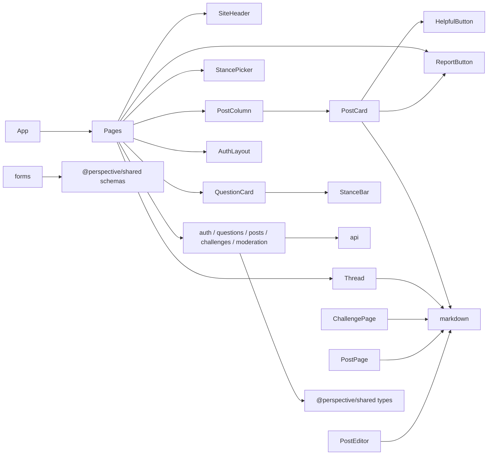

# Frontend File Guide

Every file in `apps/web/src`. Read [FRONTEND_ARCHITECTURE.md](../01_ARCHITECTURE/FRONTEND_ARCHITECTURE.md) first for the big picture.

## Core files

| File                             | Responsibility                                                                                                                                                                                                  | Key exports                                                                                                                                                                                                                 |
| -------------------------------- | --------------------------------------------------------------------------------------------------------------------------------------------------------------------------------------------------------------- | --------------------------------------------------------------------------------------------------------------------------------------------------------------------------------------------------------------------------- |
| `main.tsx`                       | Call `wakeApi()` first; create the `QueryClient` (`retry: 1` for queries); wrap the app in `StrictMode`, `QueryClientProvider`, `BrowserRouter`; import the 4 font weights and `styles.css`; mount into `#root` | none                                                                                                                                                                                                                        |
| `App.tsx`                        | Route table: `/login` and `/signup` outside the layout; everything else inside `Layout` (header + main + footer); members-only routes under `RequireAuth`; `*` → 404                                            | `App`                                                                                                                                                                                                                       |
| `api.ts`                         | `api<T>(path, {method, body})`: JSON, 204 handling, `ApiError`; `wakeApi()`; the 502 retry loop (D64)                                                                                                           | `api`, `ApiError`, `wakeApi`                                                                                                                                                                                                |
| `auth.ts`                        | Hooks for every auth endpoint; `["me"]` is the single source of "who is logged in"                                                                                                                              | `useCurrentUser`, `useLogin`, `useRegister`, `useLogout`, `useProviders`, `useGooglePending`, `useCompleteGoogleSignup`, `useResendVerification`, `useVerifyEmail`, `useForgotPassword`, `useResetPassword`, `safeRedirect` |
| `questions.ts`                   | Question hooks; a local `useDebounced` (400 ms) for duplicate suggestions                                                                                                                                       | `useQuestionList`, `useFeaturedQuestions`, `useQuestionSearch`, `useSimilarQuestions`, `useQuestion`, `useAskQuestion`                                                                                                      |
| `posts.ts`                       | Stance, column (infinite), post, write/edit/delete, vote (patches cache in place)                                                                                                                               | `useMyStance`, `useSetStance`, `useColumn`, `usePost`, `useWritePost`, `useEditPost`, `useDeletePost`, `useVote`                                                                                                            |
| `challenges.ts`                  | Challenges, threads, replies, comment delete, notifications (unread count polls every 60 s)                                                                                                                     | `usePostChallenges`, `useChallenge`, `useThread`, `useCreateChallenge`, `useReply`, `useDeleteComment`, `useUnreadCount`, `useNotifications`, `useMarkNotificationsRead`                                                    |
| `moderation.ts`                  | Report, queue, audit log, remove/restore/dismiss, ban/unban                                                                                                                                                     | `useReport`, `useQueue`, `useAudit`, `useModerate`, `useBan`                                                                                                                                                                |
| `forms.ts`                       | `validate(schema, values)` → first error per field; `errorsFromApi(err)` → field errors + form error                                                                                                            | `validate`, `errorsFromApi`, type `FieldErrors`                                                                                                                                                                             |
| `markdown.ts`                    | `renderMarkdown(source)`: `marked` (GFM, line breaks) then DOMPurify with a tag allowlist; a DOMPurify hook forces `target="_blank" rel="noopener noreferrer nofollow ugc"` on links                            | `renderMarkdown`                                                                                                                                                                                                            |
| `title.ts`                       | `usePageTitle(title)` → `"<title> · Perspective"`                                                                                                                                                               | `usePageTitle`                                                                                                                                                                                                              |
| `vite-env.d.ts`                  | Declares `import.meta.env.VITE_API_WAKE_URL` for TypeScript                                                                                                                                                     | none                                                                                                                                                                                                                        |
| `styles.css`                     | All styling: tokens, layout, header/menu, buttons, landing sections, stance bar, browse, question page and columns, post card/page, auth, forms, threads, moderation                                            | none                                                                                                                                                                                                                        |
| `assets/hero.svg`, `heading.svg` | The landing artwork and the hand-lettered heading (owner-supplied)                                                                                                                                              | none                                                                                                                                                                                                                        |

## Pages (`pages/`)

| Page                 | URL                         | Guard                                  | Data used                                                        | Notes                                                                                                                                                      |
| -------------------- | --------------------------- | -------------------------------------- | ---------------------------------------------------------------- | ---------------------------------------------------------------------------------------------------------------------------------------------------------- |
| `HomePage`           | `/`                         | none                                   | `useFeaturedQuestions` (active, 6)                               | Hero (artwork + heading + lead + 2 buttons), "How it works" (`#how`), active questions as tiles, principles, call to action; scrolls to `#hash` on arrival |
| `QuestionsPage`      | `/questions?q=&sort=`       | none                                   | `useQuestionList(sort)` or `useQuestionSearch(q)`                | Search form (keyed by query so it resets), sort buttons stored in the URL, "Show more" paging                                                              |
| `QuestionPage`       | `/q/:slug?sort=`            | none                                   | `useQuestion`, `useMyStance`, 3× `PostColumn`                    | Breadcrumb, header + `StanceSummary`, `StancePicker`, sort bar, phone tabs (`data-shown`)                                                                  |
| `PostPage`           | `/posts/:id`                | none                                   | `usePost`, `usePostChallenges`, `useQuestion(post.questionSlug)` | Full post, helpful button, challenge list, aside with the question's `StanceBar`                                                                           |
| `ChallengePage`      | `/c/:id?root=`              | none                                   | `useChallenge`, `useThread(id, root)`                            | Challenged post (or "deleted" placeholder), challenge body, discussion, `ReplyForm` for verified users                                                     |
| `AskPage`            | `/ask`                      | RequireAuth                            | `useAskQuestion`, `useSimilarQuestions(title)`                   | Unverified users see "verify first" with a resend button; "Did you mean…?" list while typing                                                               |
| `WritePostPage`      | `/q/:slug/write`            | RequireAuth                            | `useQuestion`, `useMyStance`, `useWritePost`                     | Requires a stance and a verified email; shows which column the post goes into                                                                              |
| `EditPostPage`       | `/posts/:id/edit`           | RequireAuth                            | `usePost`, `useEditPost`                                         | Reuses `PostEditor` with initial values; navigates back on success                                                                                         |
| `NewChallengePage`   | `/posts/:id/challenge`      | RequireAuth                            | `usePost`, `useCreateChallenge`                                  | Title + body; navigates to `/c/:id`                                                                                                                        |
| `NotificationsPage`  | `/notifications`            | RequireAuth                            | `useNotifications`, `useMarkNotificationsRead`                   | Opening the page marks everything read                                                                                                                     |
| `ModerationPage`     | `/moderation?tab=`          | RequireAuth (+ role check for display) | `useQueue`, `useAudit`, `useModerate`, `useBan`                  | Tabs: Reports, Audit log, Users (ban/unban by username)                                                                                                    |
| `AccountPage`        | `/account`                  | RequireAuth                            | `useCurrentUser`, `useProviders`, `useResendVerification`        | Email + verified badge, resend link, role, Google connect button or "connected"                                                                            |
| `LoginPage`          | `/login?next=&link=&error=` | none (redirects if logged in)          | `useLogin`, `useGooglePending` (when `link=google`)              | Uses `AuthLayout`; shows Google error messages from `?error=`                                                                                              |
| `SignupPage`         | `/signup`                   | none                                   | `useRegister`                                                    | `AuthLayout`; navigates to `/account`                                                                                                                      |
| `GoogleSignupPage`   | `/signup/google`            | none                                   | `useGooglePending`, `useCompleteGoogleSignup`                    | Pick a username for a new Google account; redirects to `/login?link=google` if the email already has an account                                            |
| `ForgotPasswordPage` | `/forgot-password`          | none                                   | `useForgotPassword`                                              | Always shows the same "check your inbox" message                                                                                                           |
| `ResetPasswordPage`  | `/reset-password?token=`    | none                                   | `useResetPassword`                                               | New password; logs in and goes to `/account`                                                                                                               |
| `VerifyEmailPage`    | `/verify-email?token=`      | none                                   | `useVerifyEmail(token)` (a _query_, so it runs exactly once)     | Shows "Email confirmed" or "Link not valid"                                                                                                                |
| `NotFoundPage`       | `*`                         | none                                   | none                                                             | Real 404 page with links back                                                                                                                              |

## Components (`components/`)

| Component       | Used by                                  | What it does                                                                                                                                                                                                                                                                                         |
| --------------- | ---------------------------------------- | ---------------------------------------------------------------------------------------------------------------------------------------------------------------------------------------------------------------------------------------------------------------------------------------------------- |
| `SiteHeader`    | `Layout`                                 | Brand, main nav, account menu (Log in/Sign up, or Moderation, Notifications with unread badge, username, Log out); phone menu button with `aria-expanded`; `overlay` mode on the home page. Log out navigates to `/` **before** clearing the user, so a members-only page doesn't bounce to `/login` |
| `SiteFooter`    | `Layout`                                 | Footer links                                                                                                                                                                                                                                                                                         |
| `AuthLayout`    | `LoginPage`, `SignupPage`                | Split screen: artwork on one side, form on the other; sets the page title                                                                                                                                                                                                                            |
| `RequireAuth`   | `App` routes                             | Loading → error → redirect to `/login?next=...` → `<Outlet />`                                                                                                                                                                                                                                       |
| `Field`         | forms                                    | Label + input + hint/error with `useId()` so `<label htmlFor>` and `aria-describedby` match                                                                                                                                                                                                          |
| `GoogleButton`  | Login, Account                           | A real link (`<a href="/api/auth/google/start?intent=...">`), because the browser itself must visit Google; hidden unless `/auth/providers` says Google is on                                                                                                                                        |
| `QuestionCard`  | `QuestionsPage` (row), `HomePage` (tile) | Title, `StanceBar`, "N people · M posts"; exports `formatDate`                                                                                                                                                                                                                                       |
| `StanceBar`     | cards, `PostPage`, `StanceSummary`       | `StanceBar` (three coloured segments + labels), `StanceSummary` (large version with counts); `sharesOf` makes whole percentages that always add to 100                                                                                                                                               |
| `StancePicker`  | `QuestionPage`                           | Logged out: "Log in to choose". Logged in: three buttons, a confirm step, a lock message until `changeableAt`                                                                                                                                                                                        |
| `PostColumn`    | `QuestionPage`                           | `useColumn` infinite list, "Write a post" if it's the reader's side, "Load more"                                                                                                                                                                                                                     |
| `PostCard`      | `PostColumn`                             | Badge (≥3 cross-side), title link, sanitized Markdown (clamped if >420 chars, with "Read the full post"), helpful button, meta, actions (challenges, challenge, report, edit/delete for own)                                                                                                         |
| `PostEditor`    | Write and Edit pages                     | Title + body with Write/Preview tabs; validates with `createPostSchema`; preview uses `renderMarkdown`                                                                                                                                                                                               |
| `HelpfulButton` | `PostCard`, `PostPage`                   | Shows why voting is blocked (unverified, account <24 h, no stance); toggles the vote; lightbulb icon                                                                                                                                                                                                 |
| `ReportButton`  | posts, questions, challenges, comments   | Hidden when logged out; expands into a radio list of reasons + details; shows "Reported" afterwards                                                                                                                                                                                                  |
| `Thread`        | `ChallengePage`                          | `buildTree` turns the depth-first list into nested nodes; `CommentNode` (reply, report, delete, placeholders, "Continue this thread →"); `ReplyForm`; scrolls to `#comment-<id>`                                                                                                                     |

## Tests

| File               | What it proves                                                                                                                                    |
| ------------------ | ------------------------------------------------------------------------------------------------------------------------------------------------- |
| `api.test.ts`      | While the API host is asleep, `api()` wakes it and retries 502s; gives up after two minutes; doesn't retry other errors                           |
| `markdown.test.ts` | Formatting works; scripts, event handlers, `javascript:` links, images and iframes are removed; links get safe `rel`; big headings are downgraded |

## Dependency graph (simplified)

