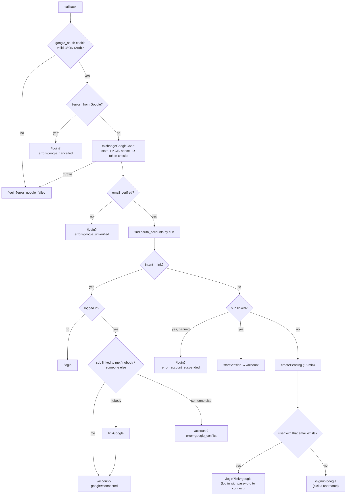

# Feature: Sign in with Google

**Status:** ✅ implemented and tested (`apps/api/test/google.test.ts`, 16 tests), ⚙️ **off in production** (Render has no `GOOGLE_CLIENT_ID`/`GOOGLE_CLIENT_SECRET`; live `/api/auth/providers` returns `{"google":false}`). To turn it on, see "Optional: Sign in with Google" in `README.md` and set the three `GOOGLE_*` variables on Render, with the redirect URI `https://perspective-lilac.vercel.app/api/auth/google/callback`.

The protocol itself (OAuth 2.0, OpenID Connect, PKCE, state, nonce) is taught in [OAUTH_FLOW.md](../07_SECURITY/OAUTH_FLOW.md). This page covers the implementation.

## Pieces

| Layer   | Files                                                                                                                                 |
| ------- | ------------------------------------------------------------------------------------------------------------------------------------- |
| Web     | `components/GoogleButton.tsx`, `pages/GoogleSignupPage.tsx`, `LoginPage.tsx` (`?link=google`, `?error=`), `AccountPage.tsx` (connect) |
| Hooks   | `useProviders`, `useGooglePending`, `useCompleteGoogleSignup` in `auth.ts`                                                            |
| API     | `modules/auth/google.ts` (protocol), `oauth.ts` (pending + linking), `google-routes.ts` (routes)                                      |
| Tables  | `oauth_accounts`, `oauth_pending`, `users`, `sessions`                                                                                |
| Cookies | `google_oauth` (10 min: state, PKCE verifier, nonce, intent), `google_pending` (15 min: token for the pending row), `session`         |

## Endpoints

| Route                                       | Purpose                                                                               |
| ------------------------------------------- | ------------------------------------------------------------------------------------- |
| `GET /auth/providers`                       | `{ google: boolean }`: is it configured? The button only renders when `true`          |
| `GET /auth/google/start?intent=login\|link` | Create state/PKCE/nonce, store them in `google_oauth`, redirect to Google (30/15 min) |
| `GET /auth/google/callback`                 | Google redirects here with `?code=&state=`; verify, then decide (30/15 min)           |
| `GET /auth/google/pending`                  | `{ email, accountExists }` for the waiting identity, or 404                           |
| `POST /auth/google/complete`                | `{ username }`: create the account for a new Google user (10/hour)                    |

## The callback's decision tree (`google-routes.ts:88`)



### Why each step exists

- **The state cookie holds the one-time values** because the callback is a fresh request from Google: the server must remember what it sent. It's `httpOnly` and expires in 10 minutes. It's cleared on every callback, even failures, so it can't be replayed.
- **The callback URL is rebuilt from `GOOGLE_REDIRECT_URI` + the query string** (`google-routes.ts:95`). openid-client must compare it with the redirect URI registered at Google; behind proxies `request.url` alone wouldn't contain the public host.
- **`email_verified` must be true:** otherwise someone could create a Google account claiming an email they don't own.
- **Banned users are refused** even with a valid Google identity.
- **Errors redirect to the website with a code** (`?error=google_failed`) instead of showing JSON, because this is a full-page browser navigation, not a `fetch`.

## The pending record (D34)

`createPending` stores `{ token_hash, provider, provider_user_id (sub), email, expires_at }` and sets the `google_pending` cookie to the raw token. Then:

- **New user** (`/signup/google`): the page calls `/auth/google/pending` to show the email, then `POST /auth/google/complete { username }`. One transaction: `insertUser` with `email_verified_at = now()` (Google verified it), insert into `oauth_accounts`, delete the pending row. Then start a session.
- **Existing email** (`/login?link=google`): the login page explains "an account with x already exists; log in to connect". After a successful **password** login, `linkPendingGoogle` deletes the pending row and links only if `pending.email === user.email.toLowerCase()`. If you log in to a different account, nothing is linked (test `google.test.ts:240`).

**Why everything goes through the server-side record:** the browser never sends the Google identity back to us. It sends only a random token, and the trusted data (sub, verified email) stays in our database. A tampered request can't claim a different `sub`.

## Protocol details in `google.ts`

```ts
config ??= oidc
  .discovery(new URL("https://accounts.google.com"), CLIENT_ID, CLIENT_SECRET)
  .then((d) => {
    oidc.enableNonRepudiationChecks(d);
    return d;
  })
  .catch((err) => {
    config = undefined;
    throw err;
  });
```

- **Discovery** downloads Google's endpoints and signing keys once; the _promise_ is cached (`??=` assigns only if `config` is undefined). If discovery fails, the cache is reset so the next attempt retries instead of failing forever.
- **`enableNonRepudiationChecks`** makes openid-client verify the ID token's JWS signature (D34: "ID-token signature checks turned on").
- **`buildAuthorizationUrl`** with `scope: "openid email"` (the minimum: no profile, no contacts), `code_challenge_method: "S256"`, and `prompt: "select_account"` (always let the user choose which Google account).
- **`authorizationCodeGrant`** with `expectedState`, `expectedNonce`, `pkceCodeVerifier`, `idTokenExpected: true`. Then `claims.sub`, a lower-cased `claims.email`, and `claims.email_verified === true`.

## Logging

Google's callback URL contains `?code=...&state=...`. `redactUrl` (`config/logger.ts:8`) replaces those values in logs. The code is single-use and short-lived, but logs are kept longer and read by more people (commit `e994d9c`).

## Tests (`apps/api/test/google.test.ts`)

The test file replaces only `modules/auth/google.ts` (`vi.mock`: `isGoogleConfigured` returns true, `createGoogleAuthorization` returns fixed checks, `exchangeGoogleCode` is a mock that each test tells "Google says this is user X"), so every routing and linking rule runs for real against the database: new users pick a username, existing accounts aren't logged into by Google alone, linking after a password login, connecting from the account page, conflicts, unverified emails, a missing state cookie, failed verification, suspended accounts, expired pending sign-ins.
