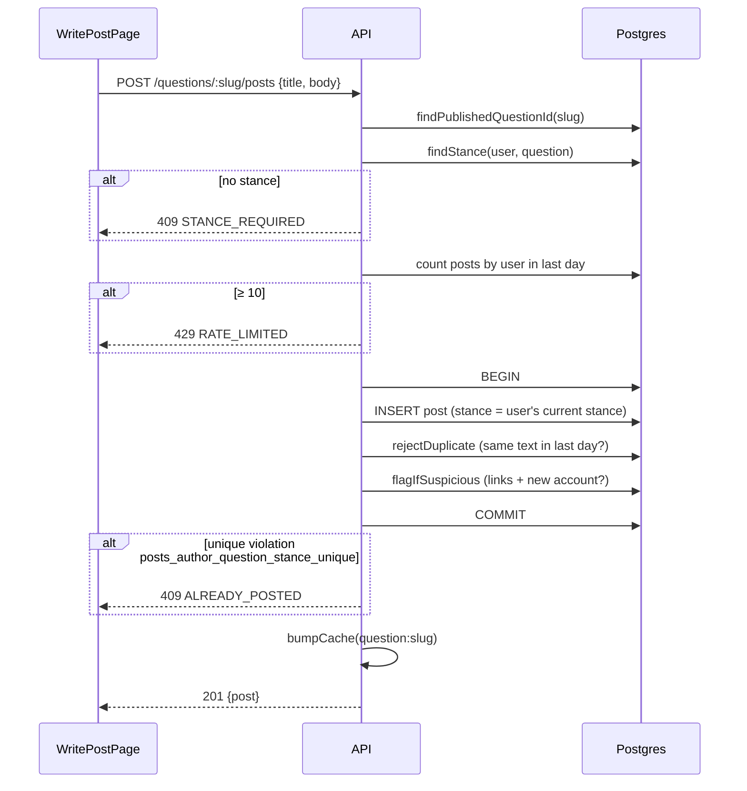

# Feature: Posts (Perspectives)

**User-facing purpose:** a post explains the reasoning behind one stance on a question. Posts fill the three columns. You can write one live post per side, edit it to improve it, or delete it.

## Pieces

| Layer      | Files                                                                                                                             |
| ---------- | --------------------------------------------------------------------------------------------------------------------------------- |
| Pages      | `WritePostPage.tsx` (`/q/:slug/write`), `EditPostPage.tsx` (`/posts/:id/edit`), `PostPage.tsx` (`/posts/:id`), `QuestionPage.tsx` |
| Components | `PostColumn.tsx`, `PostCard.tsx`, `PostEditor.tsx`, `HelpfulButton.tsx`, `ReportButton.tsx`                                       |
| Hooks      | `posts.ts`: `useColumn`, `usePost`, `useWritePost`, `useEditPost`, `useDeletePost`                                                |
| Shared     | `posts.ts`: `postTitleSchema` (5–120), `postBodySchema` (30–10,000), `createPostSchema`, `postSchema`, `postListQuerySchema`      |
| API        | `modules/posts/routes.ts`, `queries.ts`, `ranking.ts`; `moderation/spam.ts`                                                       |
| Tables     | `posts`, plus reads of `questions`, `users`, `post_votes`, `challenges`, `user_stances`; writes to `reports` (automated flags)    |

## Endpoints

| Route                                                     | Guard                  | Limits                 | Result                     |
| --------------------------------------------------------- | ---------------------- | ---------------------- | -------------------------- |
| `GET /questions/:slug/posts?stance=&sort=&cursor=&limit=` | public; lab cache      | limit 1–50, default 10 | `{ posts, nextCursor }`    |
| `POST /questions/:slug/posts`                             | `requireVerifiedEmail` | 10/day (Postgres)      | 201 `{ post }`             |
| `GET /posts/:id`                                          | public                 | none                   | `{ post }` or 404          |
| `PATCH /posts/:id`                                        | logged in, author only | 30/hour                | `{ post }` with `editedAt` |
| `DELETE /posts/:id`                                       | logged in, author only | none                   | 204 (soft delete)          |

## Writing a post (`posts/routes.ts:96`)

Key rules:

- **The column comes from the server**, not from the request. The body has only `title` and `body`; `stance` is copied from `user_stances` (D4, D41). A client can't place a post in a column it doesn't stand in.
- **One live post per side** is enforced by the partial unique index `(author_id, question_id, stance) where deleted_at is null`. The friendly error comes from catching the violation.
- **Spam checks run after the insert** inside the transaction, so the unique-index error (more specific) wins over the duplicate-text error. A duplicate rolls the insert back ([MODERATION.md](MODERATION.md)).
- **Frontend guard rails** (`WritePostPage`): without a stance or verified email it shows "Choose a side first" / "Verify your email first", and it tells you which column the post will go into.

## Reading posts

`selectPosts(viewerId, rank, reader)` returns, per post: the fields of `postSchema` plus `rank` (the active sort value, used to build the cursor). `votedByMe` comes from a left join of the viewer's own vote; `challengeCount` from a subquery counting open challenges.

The `live` filter (not deleted, not removed, question published) is applied to **every** read, including `GET /posts/:id`, voting and challenging. A removed post is gone everywhere at once.

Sorting and cursors are covered in [VOTES_AND_RANKING.md](VOTES_AND_RANKING.md).

## Editing and deleting

- `findOwnPost` → 404 if the post isn't live, 403 if you're not the author.
- **Edit** replaces `title` and `body` and sets `edited_at` (the card shows "· edited"). The stance can't be edited.
- **Delete** sets `deleted_at` (soft delete, D15). The row stays, so challenges pointing at it still open (showing "The author deleted this post"), and reports and votes keep their references. The slot for a new post on that side opens up again.

## Display

- `PostCard` renders the body through `renderMarkdown` (DOMPurify). Bodies longer than 420 characters are visually clamped with a "Read the full post" link to `/posts/:id` (D75: keeps three columns readable).
- The "Valued across sides" badge appears when `crossSideCount ≥ 3` (`CROSS_SIDE_BADGE_MIN`).
- "deleted account" replaces the author name when the author's account no longer exists (`author_id` set null).
- `PostPage` shows the full post, a byline, the helpful button, "N of them from other sides", the list of challenges, and an aside with the question's `StanceBar` and a "Read the other sides" link.
- `PostEditor` has Write/Preview tabs; the preview uses the same `renderMarkdown`, so what you preview is exactly what readers will see.

## Cache invalidation

Create, edit and delete each call `bumpCache(question:<slug>)` after their write (lab only). In the browser, writing invalidates `["posts", slug]`; editing sets `["post", id]` and invalidates all `["posts"]`; deleting invalidates `["posts"]`.

## Edge cases

| Case                                   | Result                                                                           |
| -------------------------------------- | -------------------------------------------------------------------------------- |
| Author changes stance after posting    | Post stays in its original column (snapshot)                                     |
| Second post on the same side           | 409 `ALREADY_POSTED` "Edit it instead"                                           |
| Post on the other side after switching | Allowed (different stance in the unique key) once the cooldown allows the switch |
| Same text pasted twice in a day        | 409 `DUPLICATE_CONTENT`                                                          |
| Post removed by a moderator            | Hidden everywhere; the author can't post a replacement on that side              |
| Question removed                       | Its posts disappear from every read                                              |
| Body of 29 characters                  | 400 "Explain your reasoning in at least 30 characters"                           |

## Tests

`posts.test.ts`: writing (needs verification + stance, goes in the author's column, one per side, too short, ten a day), editing/deleting (author only, soft delete, survives account deletion), columns (cursor paging, disappear with their question). E2E `posts.spec.ts`: take a side, write, edit, delete.
