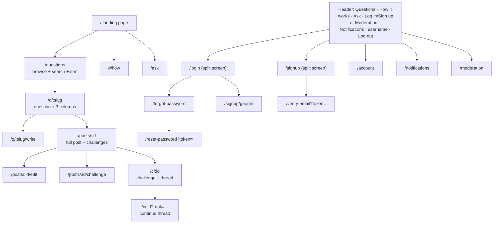

# Feature: Website Structure and Design

**Purpose:** a site that explains itself before asking anything of the visitor, works on phones, and looks finished. The current structure comes from the owner-approved redesign of 13 November 2026 (D75), on top of the visual identity from October (D55).

## Site map

## The landing page (`HomePage.tsx`)

| Section          | Content                                                                                                                                                                                                         |
| ---------------- | --------------------------------------------------------------------------------------------------------------------------------------------------------------------------------------------------------------- |
| Hero             | Full-width artwork (`hero.svg`), hand-lettered heading image (`heading.svg`, with alt text for screen readers), one-sentence lead, "Explore questions" and "Ask a question" buttons; the header is laid over it |
| How it works     | Three steps: pick a question, read every side, challenge don't shout (`id="how"`, linked from the header)                                                                                                       |
| Active questions | `useFeaturedQuestions()` → `/questions?sort=active&limit=6` rendered as tiles with stance bars                                                                                                                  |
| Why Perspective  | Three principles: reasoning before reactions, credit for crossing sides, debate has a place                                                                                                                     |
| Call to action   | "Have a question worth splitting?"                                                                                                                                                                              |

**Why a landing page before the list (D75):** a first-time visitor needs to know what the three columns and the "helped me understand" vote mean before a list of questions makes sense. The full list moved to `/questions`.

## Responsive behaviour

| Width       | Layout                                                                                                                                        |
| ----------- | --------------------------------------------------------------------------------------------------------------------------------------------- |
| > 1100 px   | Hero: artwork edge to edge, copy anchored at the right, sized in `vw` and shrunk to fit short windows (container query units)                 |
| 761–1100 px | Hero: text above, artwork below (cropped to 44vw)                                                                                             |
| ≤ 760 px    | Header links fold into a menu button (`aria-expanded`); hero art 300 px tall; question page columns become **tabs** (For / Neutral / Against) |

**Column tabs (D75):** on phones, three stacked columns made the question page about 15,700 px tall, burying the Against side at the bottom. Tabs (`QuestionPage.tsx:112`, `.columns[data-shown]` in CSS) cut it to about 6,200 px and put every side one tap away. All three columns still load; CSS hides two of them.

**The hero fit (last commit, `cdd117f`):** on a laptop window of about 1310 × 655 CSS pixels (a high-DPI screen scaled up by Windows), the heading block grew upwards into the header. The fix defines a unit `--u = min(1vw, (100cqh − 24.5vw − 104px) / 23)` inside the hero (made a size container): normally `1vw`, smaller when the space between header and artwork is short. Heading width, text and buttons are all sized in `--u`. It was checked by measuring the heading–header gap at 12 window sizes (all ≥31 px afterwards) locally and on the live site. Details in [BUGS_AND_FIXES.md](../08_BUGS_AND_DEBUGGING/BUGS_AND_FIXES.md).

## Visual identity (D55)

- Colours sampled from the artwork: cream `--bg #f1efe7`, surface `#fbfaf6`, brick red accent `#9b301e`; stance colours `--for`, `--neutral`, `--against`, plus darker `*-text` variants for readable text.
- Font: Open Sauce One, self-hosted via `@fontsource/open-sauce-one` (weights 400–700). No request to a third-party font CDN: faster and more private.
- Pill-shaped buttons (`border-radius: 999px`); variants `button-dark`, `button-outline`, `button-light`, `button-inline`, `button-small`.
- **One light theme only.** The earlier dark mode was removed because the cream artwork clashes with a dark background.

## Accessibility details in the code

- `aria-pressed` on toggle buttons (sorts, stances, tabs), `aria-expanded`/`aria-controls` on the menu button, `aria-label`s on button groups, `role="search"` on the search form, `aria-live="polite"` on duplicate suggestions, an `aria-label` on the stance bar describing the percentages, `useId()` to connect labels, hints and errors in `Field`, a breadcrumb `nav` with `aria-label`.
- Decorative SVG icons have `aria-hidden="true"`.

## Page titles

`usePageTitle(title)` sets `document.title` to `"<title> · Perspective"`, or just `"Perspective"` on the home page, so browser tabs and history are readable.

## 404 handling

The SPA catches unknown paths with `<Route path="*" element={<NotFoundPage />} />`. Server-side, Vercel rewrites every path to `index.html`, so the React router decides. Unknown API paths are a different matter: they return the JSON 404 from `notFoundHandler`.
