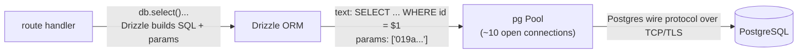

# Database Fundamentals, Taught Through Perspective

This page assumes you know basic programming but have never used a database seriously. Every concept is shown with a real example from Perspective.

## 1. What a relational database is

A **database** is a program whose job is to store data safely and answer questions about it quickly, even when many people use it at once and even if the power goes out.

A **relational** database (PostgreSQL, "Postgres") stores data in **tables**. A table is like a spreadsheet with strict rules:

- **Columns** have a name and a **type** (`text`, `integer`, `uuid`, `timestamp with time zone`…). A column of type `integer` can never contain `"hello"`.
- **Rows** are the records. Each row of `users` is one account.

```
users
┌──────────────────────────────────────┬──────────┬──────────────────┬──────┬─────────────────────┐
│ id (uuid)                            │ username │ email            │ role │ email_verified_at   │
├──────────────────────────────────────┼──────────┼──────────────────┼──────┼─────────────────────┤
│ 019a...e1                            │ sam      │ sam@example.com  │ user │ 2026-10-03 09:12+00 │
│ 019a...f7                            │ priya    │ priya@example.com│ admin│ null                │
└──────────────────────────────────────┴──────────┴──────────────────┴──────┴─────────────────────┘
```

You talk to it in **SQL** (Structured Query Language):

```sql
SELECT username, role FROM users WHERE email = 'sam@example.com';
INSERT INTO users (username, email) VALUES ('alex', 'alex@example.com');
UPDATE users SET role = 'moderator' WHERE username = 'alex';
DELETE FROM sessions WHERE expires_at < now();
```

**Why "relational":** tables _relate_ to each other through ids. A post doesn't copy its author's name; it stores the author's `id`, and a **join** looks the name up when needed. If the author renames themselves, every post shows the new name automatically. (Perspective doesn't allow renames, but the principle holds.)

## 2. `null`: "no value"

`null` means "unknown / not set". It is not zero and not an empty string. Perspective uses it on purpose:

| Column                    | `null` means                     |
| ------------------------- | -------------------------------- |
| `users.password_hash`     | Google-only account, no password |
| `users.email_verified_at` | not verified yet                 |
| `users.banned_at`         | not banned                       |
| `posts.deleted_at`        | not deleted                      |
| `posts.author_id`         | the author's account was deleted |
| `comments.parent_id`      | a top-level comment              |

Storing _when_ something happened (`email_verified_at`) instead of a yes/no flag (`is_verified`) gives you both answers: "is it verified?" (`is not null`) and "since when?".

**A trap:** `null = null` is not true in SQL (it's `null`, "unknown"). You must write `x IS NULL`. Drizzle's `isNull(posts.deletedAt)` produces exactly that.

## 3. Primary keys

Every table needs a way to point at exactly one row: its **primary key** (PK). The database guarantees it's unique and never null.

- Most Perspective tables use `id uuid PRIMARY KEY DEFAULT uuidv7()`: the database generates the id itself.
- Some use a **composite** primary key of two columns: `user_stances (user_id, question_id)`. The _pair_ must be unique, which is exactly the rule "one stance per person per question". The database enforces the rule; no application code can break it.

### UUIDv7, explained

A UUID is a 128-bit number usually written as 36 characters, e.g. `01a181a6-32f4-7e2a-ad4d-6d51d69328d2`. Version 7 starts with the current time in milliseconds (`01a181a632f4` above) followed by random bits. Consequences:

- **Not guessable:** you can't step from one id to the next like `/users/1042` → `/users/1043`.
- **Time-ordered:** later ids sort after earlier ones, so "newest first" is just `ORDER BY id DESC`.
- **Index-friendly:** new ids are always added at the end of the index, like counting numbers. Random UUIDv4s would be inserted all over it.

Postgres 18 added the built-in `uuidv7()` function, which is one reason the project uses Postgres 18 (D26).

## 4. Foreign keys: relationships the database enforces

A **foreign key** (FK) says "this column must contain an id that exists in that other table":

```sql
sessions.user_id uuid NOT NULL REFERENCES users(id) ON DELETE CASCADE
```

- You can't create a session for a user that doesn't exist.
- `ON DELETE CASCADE`: when the user is deleted, their sessions are deleted automatically.
- `ON DELETE SET NULL` (used on `posts.author_id`): when the user is deleted, the post stays and its author becomes `null`, shown as "deleted account".

Perspective's rule of thumb: **personal data cascades** (sessions, stances, votes, notifications), **public content survives** (questions, posts, challenges, comments). See [RELATIONSHIPS_AND_CONSTRAINTS.md](RELATIONSHIPS_AND_CONSTRAINTS.md).

## 5. Constraints: rules inside the database

| Kind       | Example in Perspective                                                                                                         |
| ---------- | ------------------------------------------------------------------------------------------------------------------------------ |
| `NOT NULL` | `users.username text NOT NULL`                                                                                                 |
| `UNIQUE`   | `unique index on lower(email)`                                                                                                 |
| `CHECK`    | `CHECK (char_length(title) BETWEEN 10 AND 150)`, `CHECK (depth BETWEEN 1 AND 50)`, `CHECK (username ~ '^[A-Za-z0-9_]{3,20}$')` |
| `DEFAULT`  | `role DEFAULT 'user'`, `created_at DEFAULT now()`                                                                              |
| Enum type  | `stance` can only be `'for'`, `'neutral'` or `'against'`                                                                       |

**Why repeat rules the API already checks?** The API is one program that can have bugs, and scripts or future code may bypass it. The database is the last line of defence, and unique constraints are the _only_ defence against race conditions (two requests at the same instant).

## 6. Indexes: how lookups get fast

Without an index, `WHERE token_hash = '…'` makes Postgres read **every** row of `sessions` (a _sequential scan_). An **index** is a separate sorted structure (usually a **B-tree**) that maps values to row locations, like a book's index. With `sessions_token_hash_unique`, finding one session among millions takes a handful of page reads.

Indexes cost disk space and slow down writes a little (every insert updates every index on the table), so you add them for the queries you actually run. Perspective's indexes, and how each one was justified, are in [INDEXING_AND_QUERY_OPTIMIZATION.md](INDEXING_AND_QUERY_OPTIMIZATION.md).

## 7. Joins

A **join** combines rows from two tables that match on a condition:

```sql
SELECT posts.title, users.username
FROM posts
LEFT JOIN users ON users.id = posts.author_id;
```

- `INNER JOIN` keeps only rows that match on both sides (a session whose user exists).
- `LEFT JOIN` keeps every row from the left table, filling the right side with nulls when there's no match (a post whose author was deleted still appears, with `username = null`).

Perspective's column query joins four tables in one go: posts → questions (is it published?) → users (author name) → post_votes (did _I_ vote?).

## 8. Transactions: all or nothing

A **transaction** groups statements so that either **all** of them happen or **none** do:

```sql
BEGIN;
INSERT INTO post_votes (...) VALUES (...);
UPDATE posts SET helpful_score = helpful_score + 3 WHERE id = ...;
COMMIT;      -- or ROLLBACK if anything failed
```

If the server crashes between the two statements, the database undoes the insert on restart. The vote and the score can never disagree. This is the **A** (atomicity) in **ACID**:

| Letter | Means       | In plain words                                                            |
| ------ | ----------- | ------------------------------------------------------------------------- |
| A      | Atomicity   | All or nothing                                                            |
| C      | Consistency | Constraints hold after every transaction                                  |
| I      | Isolation   | Concurrent transactions don't see each other's half-finished work         |
| D      | Durability  | Once committed, it survives a crash (it's in the write-ahead log on disk) |

In Drizzle: `await db.transaction(async (tx) => { ... })`. Use `tx`, not `db`, inside; if the callback throws, Drizzle rolls back.

## 9. Concurrency and locks

Many requests run at the same time. Two classic problems, both handled in Perspective:

- **Lost update:** two votes read `score = 10`, both write 13, so one vote is lost. **Fix:** let the database do the arithmetic, `SET helpful_score = helpful_score + 3`. The `UPDATE` locks the row, so the second waits and adds to 13.
- **Check-then-act race:** two stance changes both check "last change > 24 h ago?", both see yes, both change. **Fix:** `SELECT ... FOR UPDATE` locks the row during the transaction, so the second check happens after the first change commits.

More in [SQL_CONCEPTS_USED.md](SQL_CONCEPTS_USED.md).

## 10. Normalisation (and when to break it)

**Normalisation** means storing each fact once. Perspective is normalised in general: the username lives only in `users`; posts store `author_id`.

It **denormalises on purpose** for performance: `posts.helpful_score` could be computed as `SUM(weight)` from `post_votes`, and `questions.for_count` as `COUNT(*)` from `user_stances`. They're stored because listings are read far more often than votes happen. The risk (the stored copy drifting from the truth) is controlled by updating both in one transaction. See [DATABASE_DESIGN_TRADEOFFS.md](DATABASE_DESIGN_TRADEOFFS.md).

## 11. Migrations

The database schema changes over time (new tables, new columns). A **migration** is a numbered SQL file that moves the database from one version to the next. They're applied in order, exactly once, and recorded in a history table, so every database (yours, CI's, production's) ends up identical. Perspective has 13 (`0000`–`0012`). See [MIGRATIONS_EXPLAINED.md](MIGRATIONS_EXPLAINED.md).

## 12. Roles and privileges

Postgres has its own users ("roles") and permissions. Perspective's server logs in as `perspective_app`, which can read and write rows but can't create, alter or drop tables, and can't modify the audit log. See [DATABASE_ARCHITECTURE.md](../01_ARCHITECTURE/DATABASE_ARCHITECTURE.md#roles-and-permissions).

## 13. How the API talks to Postgres



- **Drizzle** turns TypeScript calls into SQL and gives the results TypeScript types.
- **Parameters** (`$1`) are sent separately from the SQL text, so user input can never become SQL code. That's why SQL injection isn't possible here.
- The **pool** keeps connections open and lends them to queries, because opening a new connection (TCP + TLS + authentication) takes far longer than a typical query.

Next: [SCHEMA_EXPLANATION.md](SCHEMA_EXPLANATION.md), every table and column.
