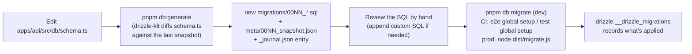

# Migrations Explained

## What a migration is, and why not just edit the database

Your local database, the test database, CI's throwaway database and Neon in production must all have **exactly** the same structure. If you added a column by typing SQL into one of them, the others would silently differ. A **migration** is a numbered SQL file checked into git; a tool applies the ones a database hasn't seen yet, in order, and records them. The database's structure then becomes part of the code's history: reviewable, repeatable and reversible through new migrations.

## The workflow in Perspective



- **drizzle-kit** (development tool) _generates_ SQL by comparing `schema.ts` with the previous snapshot. `strict: true` makes it ask instead of guessing in ambiguous cases (did you rename a column or drop one and add another?), since guessing wrong drops data.
- **drizzle-orm's migrator** (runtime library) _applies_ migrations. Production uses only this, so drizzle-kit doesn't ship in the image.
- The generated SQL uses `--> statement-breakpoint` markers to separate statements.
- `.prettierignore` excludes `apps/api/migrations/`: generated files must stay exactly as written. A migration that has already been applied somewhere must never change, and reformatting it would create a diff that looks like a real change. (Drizzle also stores a hash of each applied file in its history table.)

## Applying safely in production (`apps/api/src/migrate.ts`)

```ts
const client = new pg.Client({ connectionString: MIGRATION_DATABASE_URL });
await client.connect();
try {
  await client.query("select pg_advisory_lock($1)", [7_212_001]);
  await migrate(drizzle({ client }), { migrationsFolder: "./migrations" });
} finally {
  await client.end(); // releases the lock
}
```

- **Advisory lock:** a lock on an arbitrary number that Postgres manages but doesn't attach to any table. If two containers start together, the second waits on `pg_advisory_lock` until the first finishes; then it sees everything applied and does nothing. Without it, both might run the same `CREATE TABLE` and one would crash, or worse, half-apply.
- **A plain `pg.Client`**, not a pool: the lock belongs to one connection (session-level), so the whole migration must run on that same connection.
- The lock is released automatically when the connection closes, even after a crash.

## Each migration, and why it exists

### `0000_clumsy_lethal_legion.sql` (Phase 0)

Creates only the enum `stance`. The first migration proved the workflow end to end before any real tables existed.

### `0001_unusual_leper_queen.sql` (Phase 1, `75b40b8`)

`user_role` enum; `users` (with the username regex check) and `sessions`; the cascade FK; unique `token_hash`; `sessions_user_id_idx`; unique indexes on `lower(email)` and `lower(username)`.

### `0002_jittery_carnage.sql` (Phase 1, Google)

`oauth_provider` enum; `oauth_accounts` with the composite PK and `(user_id, provider)` unique; `oauth_pending`.

### `0003_spicy_shotgun.sql` (Phase 1, email links)

`email_token_purpose` enum; `email_tokens`.

### `0004_enable_pg_trgm.sql` (Phase 2) — hand-written

```sql
-- Trigram matching for "did you mean...?" suggestions on question titles.
CREATE EXTENSION IF NOT EXISTS pg_trgm;
```

drizzle-kit doesn't manage extensions, so this was created as a custom migration. It must come before `0005`, whose trigram index needs the `gin_trgm_ops` operator class. Creating an extension requires the `CREATE` privilege on the database, which the migrator role has.

### `0005_cloudy_brood.sql` (Phase 2)

`question_status` enum; `questions` with the `GENERATED ALWAYS AS (...) STORED` tsvector; GIN search index; GIN trigram index; slug unique; `(status, id desc)`; `(created_by, created_at)`; length checks.

### `0006_broad_amazoness.sql` (Phase 3)

`user_stances`, `stance_history`, `posts`; the first `posts_column_idx` (partial on `deleted_at IS NULL`); the partial unique one-post-per-side index.

### `0007_clean_frog_thor.sql` (Phase 4)

`post_votes`; `helpful_score`, `helpful_count`, `cross_side_count` added to `posts` (with `DEFAULT 0 NOT NULL`, so existing rows are valid immediately); the first `posts_column_top_idx`.

### `0008_flaky_mentallo.sql` (Phase 5)

`challenge_status` and `notification_type` enums; `challenges`, `comments` (self-FK), `notifications` with the partial unread index.

### `0009_fantastic_firebrand.sql` (Phase 6) — generated + hand-appended

Moderation enums; `reports`, `audit_log`; `removed_at` on posts and comments. The last line was added by hand:

```sql
-- Append-only audit log: the app can add and read entries, never rewrite them.
REVOKE UPDATE, DELETE, TRUNCATE ON "audit_log" FROM perspective_app;
```

Why it works: when the migrator creates the table, `ALTER DEFAULT PRIVILEGES` grants the app `SELECT, INSERT, UPDATE, DELETE`; the `REVOKE` immediately takes back `UPDATE` and `DELETE` (and `TRUNCATE`, for good measure) for this one table.

### `0010_tricky_archangel.sql` (Phase 9, D66)

```sql
DROP INDEX "posts_column_idx";
DROP INDEX "posts_column_top_idx";
CREATE INDEX "posts_column_idx" ON posts (question_id, stance, id DESC NULLS LAST)
  WHERE deleted_at IS NULL AND removed_at IS NULL;
CREATE INDEX "posts_column_top_idx" ON posts (question_id, stance, helpful_score DESC NULLS LAST, id DESC NULLS LAST)
  WHERE deleted_at IS NULL AND removed_at IS NULL;
```

The index conditions now match the listing's filter exactly. Busiest column: 3.0 ms → 0.4 ms. (Note the `DESC NULLS LAST`, Drizzle's output for `.desc()`. The column queries use `ORDER BY ... DESC`, which in Postgres means `NULLS FIRST`. That exact mismatch was later found to cost an extra sort step on the question indexes and fixed in 0012. Whether the post-column indexes have the same small cost was **not measured**. **RECOMMENDATION:** run `EXPLAIN (ANALYZE)` on a busy column's Top query, and if a sort step appears, rebuild these two indexes with `.nullsFirst()` as in 0012.)

**Production note recorded in D66:** on a large live table, `DROP`/`CREATE INDEX` inside a transaction blocks writes while building. Production-scale changes would use `CREATE INDEX CONCURRENTLY` outside a transaction.

### `0011_mysterious_gorilla_man.sql` (D74) — generated + hand-appended backfill

Adds `for_count`, `neutral_count`, `against_count` (`DEFAULT 0 NOT NULL`), then **backfills** them from existing stances:

```sql
UPDATE questions q SET for_count = s.for_count, neutral_count = s.neutral_count, against_count = s.against_count
FROM (SELECT question_id,
             count(*) FILTER (WHERE stance = 'for')::int     AS for_count,
             count(*) FILTER (WHERE stance = 'neutral')::int AS neutral_count,
             count(*) FILTER (WHERE stance = 'against')::int AS against_count
      FROM user_stances GROUP BY question_id) s
WHERE s.question_id = q.id;
```

Then the two ranking indexes and the non-negative check. **Why the backfill belongs in the migration:** the new code assumes the counts are correct. If they started at 0, every existing question would show "no one has taken a side" until someone changed a stance, and that drift would never fix itself.

### `0012_puzzling_lenny_balinger.sql` (D74)

Rebuilds `questions_active_idx` and `questions_divided_idx` with `id DESC NULLS FIRST`. `ORDER BY ... id DESC` in Postgres means `NULLS FIRST`; an index built `NULLS LAST` doesn't match that ordering, so the planner added an _incremental sort_ step. Matching it made the next page a pure index scan (3.4 ms → 0.5 ms on 50,000 questions). In `schema.ts` this is written `t.id.desc().nullsFirst()`.

## Rules of thumb learned

1. **Never edit an applied migration.** Write a new one (0010 and 0012 are "fix the index" migrations, not edits).
2. **Read the generated SQL.** drizzle-kit can't know about backfills, extensions or grants; append them.
3. **New `NOT NULL` columns need a `DEFAULT`** (or a backfill) so existing rows stay valid.
4. **Index definitions must mirror queries**, including partial conditions and NULLS ordering.
5. **Migrations run as a different role** from the app, and the running server never holds that role's password.
