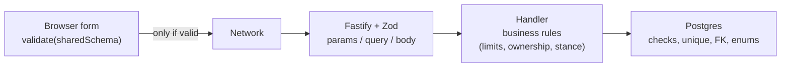

# Validation and Error Handling

## Where validation happens



| Layer          | Catches                                                  | On failure                                        | Can it be bypassed? |
| -------------- | -------------------------------------------------------- | ------------------------------------------------- | ------------------- |
| Browser        | format, lengths, required fields                         | field messages, no request                        | yes, trivially      |
| Zod in Fastify | the same rules + types, ids, enums, cursors              | 400 `VALIDATION_FAILED` with `details[]`          | no                  |
| Handler        | rules that need data: daily limits, ownership, cooldowns | specific `AppError`                               | no                  |
| Database       | uniqueness, races, lengths, formats, relationships       | an exception, mapped to a friendly error or a 500 | no                  |

The browser layer is for **user experience**; the other three are for **correctness and security**.

## Zod in practice

```ts
export const questionTitleSchema = z
  .string()
  .trim()
  .transform((title) => title.replace(/\s+/g, " "))
  .pipe(
    z
      .string()
      .min(10, "Use at least 10 characters")
      .max(150, "...")
      .endsWith("?", "Phrase it as a question ending with ?"),
  );
```

- **Transform, then validate:** `.trim()` and `.transform()` clean the input, `.pipe()` validates the cleaned value. The handler receives the cleaned value.
- **Human messages live in the schema**, so the browser and the API show the same wording.
- **`z.coerce.number()`** for query strings and env vars, which always arrive as strings.
- **`.default(...)`** fills missing optional values (`sort` defaults to `"new"` or `"top"`).
- **Zod also guards things that aren't request bodies:** environment variables, the JSON in the Google state cookie, post cursors after base64 decoding, CLI arguments in `set-role.ts`.

## The error contract

```ts
// packages/shared/src/errors.ts
export interface ErrorResponse {
  error: { code: ErrorCode; message: string; details?: ErrorDetail[] };
}
```

Example validation failure:

```json
{
  "error": {
    "code": "VALIDATION_FAILED",
    "message": "Some fields are invalid",
    "details": [
      { "path": "title", "message": "Phrase it as a question ending with ?" }
    ]
  }
}
```

`path` is built from Fastify's `instancePath` (`/title` → `title`, `/a/b` → `a.b`).

## The error handler's four branches (`plugins/error-handler.ts`)

1. **`AppError`** (thrown on purpose): status, code and message as given. These messages are written for users.
2. **Validation error** (`error.validation`): 400 with one detail per issue.
3. **Other 4xx from Fastify** (malformed JSON, 415, body too large): status kept, code `BAD_REQUEST`, Fastify's message (safe to show), logged at `info`.
4. **Everything else:** logged at `error` with the full error and stack; the client gets 500 `INTERNAL_ERROR` "Something went wrong".

**Why hide unexpected errors:** a raw Postgres error might say `duplicate key value violates unique constraint "users_email_lower_unique"` or include a SQL fragment; a stack trace shows file paths and library versions. That's free reconnaissance for an attacker, and confusing for users. Test: `server.test.ts:35` ("hide the details of unexpected failures").

**Unknown routes** go to `notFoundHandler` → 404 `NOT_FOUND` "Route GET /x not found", in the same shape.

## Turning database errors into user errors

```ts
try {
  await insert...;
} catch (err) {
  if (uniqueViolation(err) === "posts_author_question_stance_unique") {
    throw new AppError(409, "ALREADY_POSTED", "You already have a post on this side. Edit it instead.");
  }
  throw err;            // anything else stays a 500
}
```

Pattern: catch, recognise **one specific** constraint by name, translate it, and rethrow everything else unchanged. Never swallow unknown errors.

## Errors that are deliberately _not_ raised

- **Signup email failure:** logged, not thrown; the account still gets created.
- **Cache and Redis failures:** logged as warnings; the request continues without the cache (`cache.ts`).
- **Rate-limit store failure:** `skipOnError: true`.
- **Re-reporting or re-voting:** a no-op, not an error.
- **Notification for a deleted account:** silently skipped.

These are all cases where failing the user's action would be worse than continuing.

## On the frontend

- `api()` converts any non-2xx response into `ApiError { status, code, message, details }`, with a generic fallback for non-JSON responses (e.g. an HTML error page from a proxy).
- `errorsFromApi(err)` maps `details` to fields and `EMAIL_TAKEN`/`USERNAME_TAKEN` to their fields; otherwise one form message. A non-`ApiError` (network failure) becomes "Can't reach the server. Try again."
- Pages switch on `status` or `code` for specific screens: 404 → "Question not found"; 401 from `/auth/me` → logged out.
- TanStack Query retries failed queries once (`retry: 1` in `main.tsx`); queries where a 404 is a final answer (`useQuestion`, `usePost`, `useChallenge`) set `retry: false`.

## Startup validation

`env.ts` validates all configuration before the server starts and exits with a readable list of problems. Tests: `server.test.ts:157` (invalid config refused), `:178` (production without SMTP refused), `:196` (`WEB_ORIGIN` with a trailing slash normalised).
