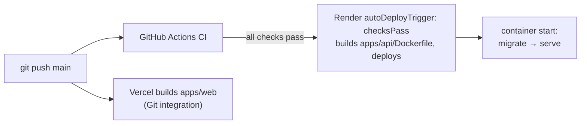

# CI/CD Explained

**CI (continuous integration):** every push is automatically checked. **CD (continuous deployment):** checked code is automatically deployed.

## The workflow (`.github/workflows/ci.yml`)

Triggers: every `push` and `pull_request`. Permissions: `contents: read` (the job's GitHub token can't modify the repository). Concurrency: a newer push to the same branch cancels the older run.

### Job `check` (ubuntu-latest, 20 min limit)

| Step                                                | Why                                                                                               |
| --------------------------------------------------- | ------------------------------------------------------------------------------------------------- |
| `actions/checkout@v5`                               | get the code                                                                                      |
| `pnpm/action-setup@v4`                              | pnpm (version from `packageManager`)                                                              |
| `actions/setup-node@v5` (`.nvmrc`, pnpm cache)      | Node 22; cached dependency store                                                                  |
| `docker compose up -d --wait`                       | the **same** Postgres + init script as local development, with throwaway CI passwords from `env:` |
| `pnpm install --frozen-lockfile`                    | exactly the locked versions; fails if the lockfile is stale                                       |
| `pnpm format:check`                                 | Prettier                                                                                          |
| `pnpm typecheck`                                    | `tsc` on all 5 configs                                                                            |
| `pnpm lint`                                         | type-aware ESLint                                                                                 |
| `pnpm audit --audit-level high`                     | fail on high or critical advisories (D60)                                                         |
| `pnpm test`                                         | unit + API integration (Redis is started by compose too)                                          |
| `pnpm build`                                        | the web production build                                                                          |
| `playwright install --with-deps chromium`           | browser + OS libraries                                                                            |
| `pnpm test:e2e`                                     | end-to-end                                                                                        |
| on failure: upload `e2e/playwright-report` (7 days) | traces and screenshots for debugging                                                              |

### Job `images` (parallel, 15 min)

`docker build -f apps/api/Dockerfile .` and `docker build -f apps/web/Dockerfile .`, so a broken Dockerfile is caught before Render tries to deploy it.

## CD

- **Render** deploys only commits whose checks passed (`render.yaml`: `autoDeployTrigger: checksPass`).
- **Vercel** builds and deploys the website from its Git integration on every push to `main`.
- Migrations run on container start (D57).
- **(Observation)** the website can therefore go live slightly before the API (Vercel doesn't wait for CI). Both are backwards-compatible in practice because API changes in this project were additive; a breaking API change would need ordering.

## Dependabot (`.github/dependabot.yml`)

Weekly PRs for npm (minor and patch updates grouped into one PR), GitHub Actions and the two Dockerfiles. Major updates of Node and `@types/node` are ignored: moving off Node 22 LTS is a deliberate decision, not a weekly chore. Each PR runs CI like any other.

## Branch and commit practice

Work happens on `main`; commits are short plain-English descriptions (D29). The AI assistant could commit but only pushed with the owner's explicit permission, and the owner checked CI before deployment steps.
