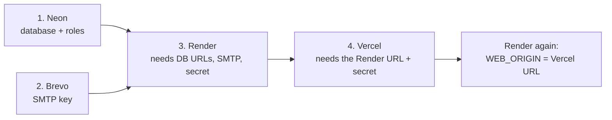

# Deployment Guide

`docs/DEPLOYMENT.md` holds the exact click-by-click steps. This page explains what each step achieves, in the order they depend on each other, and how to redeploy or recover.

## The four services and why this order

### 1. Neon (Postgres 18)

- Create a project in the region closest to you; **Render must use the same region** (Singapore here) to keep query latency low.
- Cap compute at 0.25 CU: 100 CU-hours/month at 0.25 CU = 400 active hours.
- Run `pnpm db:setup-roles` once with the **owner's direct** (not pooled) connection string in `OWNER_DATABASE_URL`. It creates `perspective_migrator` and `perspective_app` with random passwords, applies the grants and default privileges, and prints `DATABASE_URL` and `MIGRATION_DATABASE_URL` **once**. Store them only in Render.
  - **Why direct, not pooled (reconstructed; the docs only say "direct"):** a pooled connection (PgBouncer in transaction mode) can mix sessions, which breaks session-level features like the migration's advisory lock.

### 2. Brevo (SMTP)

- Add and confirm a sender; generate an SMTP key.
- `SMTP_URL=smtp://<login with @ written as %40>:<key>@smtp-relay.brevo.com:2525`. The `@` in the login must be URL-encoded, otherwise the URL parser would read it as the separator before the host.
- Port 2525 because Render's free plan blocks 25/465/587.

### 3. Render (API)

- **New → Blueprint** reads `render.yaml`: a Docker web service, free plan, region Singapore, `healthCheckPath: /health` (liveness only, so a sleeping Neon doesn't fail health checks), `autoDeployTrigger: checksPass`.
- Enter the `sync: false` variables: `WEB_ORIGIN`, `DATABASE_URL`, `MIGRATION_DATABASE_URL`, `ORIGIN_SECRET` (`node -e "console.log(require('crypto').randomBytes(32).toString('hex'))"`), `SMTP_URL`, `EMAIL_FROM`; leave `GOOGLE_*` empty.
- Check `https://<service>.onrender.com/health`.

### 4. Vercel (website + proxy)

- Import the repo, **Root Directory `apps/web`**, framework Vite.
- Variables: `API_ORIGIN` (Render URL, no trailing slash) and `ORIGIN_SECRET`, both **Production only**; `VITE_API_WAKE_URL` (Render URL + `/health`); `ENABLE_EXPERIMENTAL_COREPACK=1`, so Vercel uses the pinned pnpm 12.
- `vercel.json` does the rest: `/api/(.*)` → `$API_ORIGIN/$1` with the secret header; long caching for `/assets/*`; every other path → `index.html`.
- Finally set Render's `WEB_ORIGIN` to the Vercel URL and redeploy the API.

## Verify a deployment

| Check                                                                      | Expect                                       |
| -------------------------------------------------------------------------- | -------------------------------------------- |
| `https://<vercel>/api/health/ready`                                        | `{"status":"ok"}`                            |
| `https://<render>/questions` called directly                               | 403 "Requests must come through the website" |
| Sign up on the live site                                                   | verification email arrives (check spam)      |
| Neon SQL: `select host(ip) from sessions order by created_at desc limit 1` | your own public IP                           |
| Response headers on `/api/...`                                             | `cache-control: no-store`, CSP, HSTS         |

## Redeploying

Push to `main`. CI runs; Render deploys when checks pass (migrating first); Vercel rebuilds. To redeploy without code changes, use each dashboard's "Redeploy".

## Rolling back

- **Code:** revert the commit and push (or redeploy a previous deployment in each dashboard).
- **Database:** migrations only go forward; to undo one, write a new migration. For data mistakes, Neon can restore to a point within the last **6 hours** (free plan). Beyond that there's no backup yet.

## Production vs everything else

| Thing             | Production                  | Local images (`--profile app`) | Lab (`--profile load`)                               |
| ----------------- | --------------------------- | ------------------------------ | ---------------------------------------------------- |
| Website           | Vercel                      | nginx container                | (none; k6 calls the API)                             |
| API instances     | 1 (Render)                  | 1                              | 1–4 behind nginx                                     |
| Database          | Neon                        | local Postgres                 | local Postgres `perspective_load` + optional replica |
| Redis             | **none**                    | yes                            | yes                                                  |
| Email             | Brevo SMTP, sent in-request | Mailpit via worker             | Mailpit                                              |
| Metrics / tracing | none                        | none                           | Prometheus, Grafana, Jaeger                          |
| IP trust          | ORIGIN_SECRET               | `TRUST_PROXY=uniquelocal`      | `TRUST_PROXY=uniquelocal`                            |
