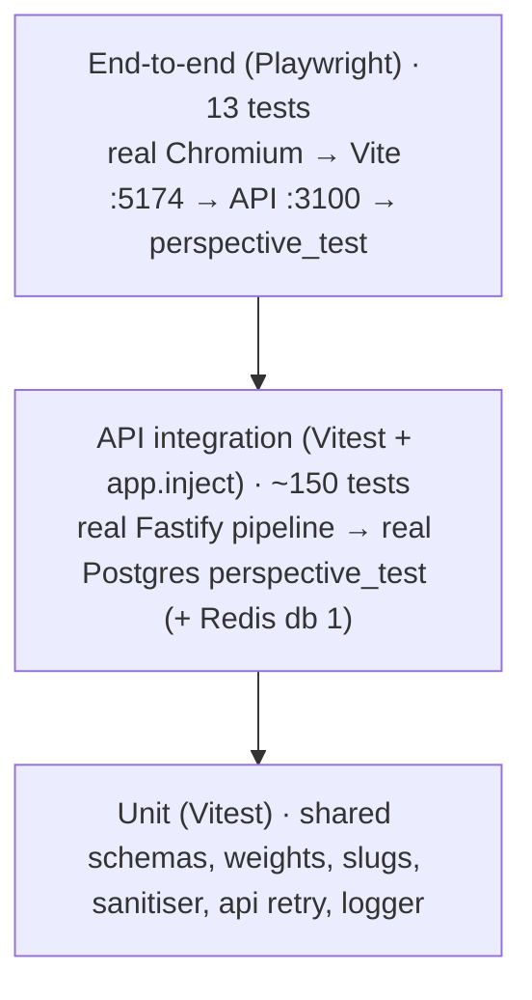

# Testing Architecture

## Three layers (D53)

| Layer       | Catches                                                                                                        | Can't catch                             | Speed   |
| ----------- | -------------------------------------------------------------------------------------------------------------- | --------------------------------------- | ------- |
| Unit        | logic mistakes in pure functions                                                                               | SQL, constraints, wiring                | ms      |
| Integration | SQL errors, constraints, transactions, races, cookies, guards, error shapes, caching                           | browser behaviour, proxy, React         | seconds |
| End-to-end  | the whole journey: forms, routing, cookies through the Vite proxy, React state bugs (like the logout redirect) | rare edge cases (too slow to enumerate) | ~minute |

**Why a real database instead of mocks (D32):** auth and voting correctness depends on Postgres behaviour (unique indexes, `FOR UPDATE`, `ON CONFLICT`, cascades, `REVOKE`). A mock would test what you _think_ Postgres does.

## Isolation

| Concern                    | How it's handled                                                                                                            |
| -------------------------- | --------------------------------------------------------------------------------------------------------------------------- |
| Don't touch dev data       | `test/env.ts` rewrites both DB URLs to `/perspective_test`; Redis to database `/1`                                          |
| Schema up to date          | Vitest `globalSetup` runs migrations once; E2E `global-setup.ts` runs `db:migrate` and empties tables                       |
| Clean state per test       | `resetDatabase()` deletes `reports`, `questions`, `users`, `oauth_pending` (cascades clear the rest) and flushes Redis db 1 |
| Shared DB → no parallelism | `fileParallelism: false` (Vitest); `workers: 1` (Playwright)                                                                |
| Two suites, one DB         | `pnpm test` excludes E2E; don't run both at once (D60)                                                                      |
| No real email              | `mailer.ts` never creates a transport when `NODE_ENV === "test"`                                                            |
| No real Google             | `vi.mock("../src/modules/auth/google")`                                                                                     |
| Silent logs                | `LOG_LEVEL=silent` in tests                                                                                                 |

## Coverage

`pnpm test:coverage` (V8 provider) reports API coverage; `server.ts` is excluded (it only wires the process). D53: "coverage is reported as a map of untested code, not a target". At the end of Phase 7 API line coverage was about 91%.

## What runs where

| Command              | Runs                                                                        |
| -------------------- | --------------------------------------------------------------------------- |
| `pnpm test`          | shared + web unit tests, API integration tests                              |
| `pnpm test:coverage` | API tests with coverage                                                     |
| `pnpm test:e2e`      | Playwright (starts its own API and Vite)                                    |
| CI                   | all of the above, plus format, typecheck, lint, audit, build, Docker builds |

Details: [UNIT_AND_INTEGRATION_TESTS.md](UNIT_AND_INTEGRATION_TESTS.md), [E2E_TESTING.md](E2E_TESTING.md), [CI_CD_EXPLAINED.md](CI_CD_EXPLAINED.md).
