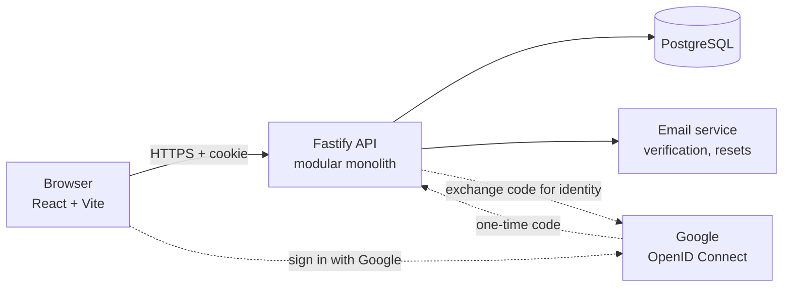
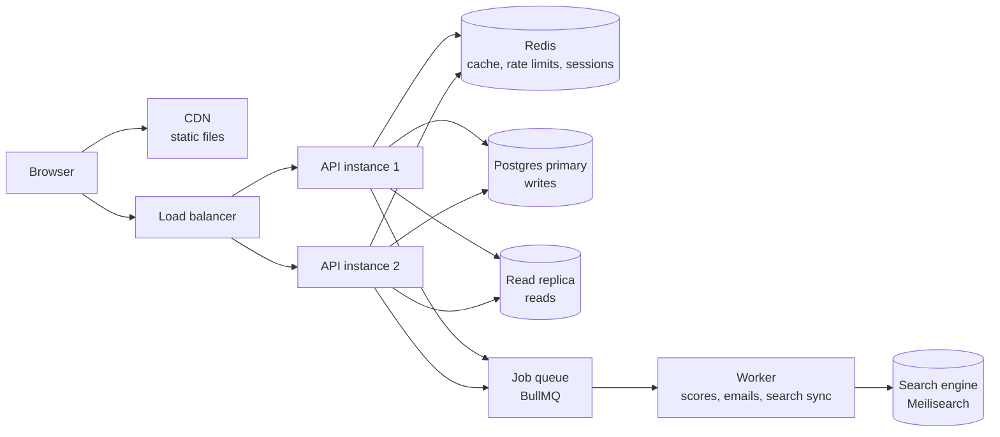
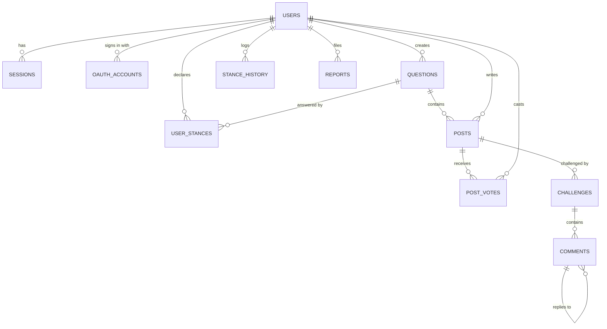

# Perspective — Full Project Roadmap

A platform where people understand viewpoints before debating them. Questions are split into **For / Neutral / Against**, posts explain reasoning, and debate only happens inside **Challenges**.

---

## How we work

- You drive every phase. I write code, then explain every file, every line that matters, and every decision.
- You run it, read it, break it, and commit it yourself.
- Anything marked **🟡 Your call** is a decision you make before we build that part.
- Every decision gets written into the Decision Log below, with _why_. By the end, you should be able to defend each one in an interview.

---

## Decision Log

| #   | Decision                                                                                                                                                                                                                                                                                                                                                   | Why                                                                                                                                                                                                                                                                                                                                                        |
| --- | ---------------------------------------------------------------------------------------------------------------------------------------------------------------------------------------------------------------------------------------------------------------------------------------------------------------------------------------------------------- | ---------------------------------------------------------------------------------------------------------------------------------------------------------------------------------------------------------------------------------------------------------------------------------------------------------------------------------------------------------- |
| D1  | TypeScript everywhere (React + Vite, Node + Fastify)                                                                                                                                                                                                                                                                                                       | One language, shared types between frontend and backend                                                                                                                                                                                                                                                                                                    |
| D2  | PostgreSQL                                                                                                                                                                                                                                                                                                                                                 | Data is relational (users → posts → votes → challenges → comments); teaches indexes, joins, transactions, query plans                                                                                                                                                                                                                                      |
| D3  | Topics are **questions** that can be answered For / Neutral / Against                                                                                                                                                                                                                                                                                      | "Abortion" can't be split; "Should abortion be legal?" can                                                                                                                                                                                                                                                                                                 |
| D4  | The **author's stance** lives on the post                                                                                                                                                                                                                                                                                                                  | It decides which column the post appears in                                                                                                                                                                                                                                                                                                                |
| D5  | The **reader's stance** lives on (user + question), not on posts                                                                                                                                                                                                                                                                                           | Needed for cross-side ranking; one stance per person per question                                                                                                                                                                                                                                                                                          |
| D6  | A reader must declare a stance on a question before marking posts "helpful" there (browsing needs no stance)                                                                                                                                                                                                                                               | Without it, cross-side credit can't be computed                                                                                                                                                                                                                                                                                                            |
| D7  | Each helpful vote stores a **snapshot** of the voter's stance at vote time                                                                                                                                                                                                                                                                                 | If someone changes their stance later, old votes keep their meaning, and scores don't need recomputing                                                                                                                                                                                                                                                     |
| D8  | Stance changes are allowed, logged in history, and limited to one per 24h per question                                                                                                                                                                                                                                                                     | People should be able to change their minds (that's the whole point), but rapid flipping to game scores is blocked                                                                                                                                                                                                                                         |
| D9  | Only positive "This helped me understand" votes, no downvotes                                                                                                                                                                                                                                                                                              | Downvotes become "I disagree" buttons; bad content is handled by reports instead                                                                                                                                                                                                                                                                           |
| D10 | Ranking rewards **cross-side** helpfulness                                                                                                                                                                                                                                                                                                                 | Matches the vision: reward understanding, not tribal agreement                                                                                                                                                                                                                                                                                             |
| D11 | Comment trees use an **adjacency list** (`parent_id`) + recursive SQL                                                                                                                                                                                                                                                                                      | Simplest to write; Postgres loads whole trees with one recursive query                                                                                                                                                                                                                                                                                     |
| D12 | Session cookies (httpOnly) instead of JWT in localStorage                                                                                                                                                                                                                                                                                                  | Sessions can be revoked instantly (logout, ban); cookies can't be read by injected JavaScript                                                                                                                                                                                                                                                              |
| D13 | Modular monolith first, split services only when measurements demand it                                                                                                                                                                                                                                                                                    | You learn _why_ to split, instead of splitting by default                                                                                                                                                                                                                                                                                                  |
| D14 | Cursor pagination instead of page numbers (offset)                                                                                                                                                                                                                                                                                                         | Offset gets slower on deep pages and skips/duplicates items when new posts arrive                                                                                                                                                                                                                                                                          |
| D15 | Soft deletes for posts and comments                                                                                                                                                                                                                                                                                                                        | Challenges and replies that point at a deleted post don't break; moderators keep a record                                                                                                                                                                                                                                                                  |
| D16 | Project name is **Perspective**; workspace packages use the `@perspective/*` scope                                                                                                                                                                                                                                                                         | Final name chosen up front so package names, container names, and docs don't need renaming later; the scope makes internal imports (`@perspective/shared`) clearly distinct from npm packages                                                                                                                                                              |
| D17 | `packages/shared` is consumed as **TypeScript source** (no build step); the API gets bundled in Phase 8                                                                                                                                                                                                                                                    | Instant feedback when shared types change and far less config (no project references, no stale `dist/`). Cost: Node can't run `.ts` imports in production, so the API must be bundled (esbuild/tsup), which also shrinks the Docker image                                                                                                                  |
| D18 | Type-aware ESLint (`strictTypeChecked`), so **TypeScript is pinned to 6.0.x** instead of 7.x                                                                                                                                                                                                                                                               | Type-aware rules catch real bugs like un-awaited promises. typescript-eslint doesn't support TS 7 (the Go rewrite) yet. Revisit when it does, for TS 7's faster type-checking                                                                                                                                                                              |
| D19 | Two Postgres roles: `perspective_migrator` (owns schema, runs migrations) and `perspective_app` (row access only: SELECT/INSERT/UPDATE/DELETE)                                                                                                                                                                                                             | Least privilege: a compromised server (e.g. SQL injection) can misuse rows but can't DROP, ALTER, or TRUNCATE tables. `ALTER DEFAULT PRIVILEGES` grants the app access to future tables automatically. Cheaper to set up now than to re-own tables later                                                                                                   |
| D20 | **Zod** for all validation (env config, request schemas, shared frontend/backend schemas)                                                                                                                                                                                                                                                                  | Readable, clear error messages, the standard for React forms (schemas in `packages/shared` get reused by the frontend), most transferable skill. TypeBox is faster and Fastify-native, but validation cost is microseconds next to DB queries; measure it in Phase 9 instead of assuming                                                                   |
| D21 | One `.env` at the repo root, loaded by the API with Node's built-in `--env-file`                                                                                                                                                                                                                                                                           | Docker Compose already reads the root `.env`; one file means one place for secrets. Node's built-in loader avoids the `dotenv` dependency                                                                                                                                                                                                                  |
| D22 | Error responses use our own shape: `{ error: { code, message, details? } }`, with `code` typed in `packages/shared`                                                                                                                                                                                                                                        | `code` is a stable contract the frontend can switch on while messages stay free to change; `details` gives per-field errors for forms. Simpler than RFC 9457 Problem Details for a single-client API, and easy to translate to it later if the API goes public                                                                                             |
| D23 | Conventional Commits, documented in the README but not enforced by git hooks                                                                                                                                                                                                                                                                               | Solo project that already follows the format; hooks (husky + commitlint) would add two tools for little gain. Revisit in Phase 8 as a CI check if needed                                                                                                                                                                                                   |
| D24 | Sign-in supports **both** Google (OAuth 2.0 / OpenID Connect) and email + password                                                                                                                                                                                                                                                                         | Google is what users expect and skips email verification; email + password works for people without (or not wanting) Google, avoids depending on one provider, and keeps the security lessons (argon2id, reset tokens, brute-force limits). Google only answers "who is this?": after that, both methods issue the same session cookie (D12)               |
| D25 | Phase 1 order: tables → email/password API → first web pages → Google sign-in → email verification + password reset → roles                                                                                                                                                                                                                                | Seeing working pages early makes the backend concrete; Google needs a page to put its button on. Security items (hashing, rate limits, headers) still ship with the first auth code                                                                                                                                                                        |
| D26 | Primary keys are **UUIDv7**, generated by Postgres 18's built-in `uuidv7()`                                                                                                                                                                                                                                                                                | Sequential numbers leak how many users/posts exist and let people step through `/users/1042`, `/users/1043`. UUIDv7 starts with a timestamp, so new IDs stay in order and index inserts stay fast (unlike random UUIDv4). Cost: 16 bytes instead of 8, measured in Phase 9                                                                                 |
| D27 | **No automatic account linking by matching email.** A Google identity is attached to an existing account only after the person proves control of that account: either they connect Google while logged in, or a Google sign-in whose email matches an existing account is held as a short-lived, single-use pending link until they log in to that account | Auto-linking on email enables pre-account takeover: an attacker registers your email with their own password first, and when you later sign in with Google, both of you control one account. Google identities are always matched by Google's stable user ID (`sub`), never by email                                                                       |
| D28 | Emails and usernames are unique **ignoring capitals**; usernames are 3–20 characters of letters, digits and `_`                                                                                                                                                                                                                                            | `Sam@Mail.com` and `sam@mail.com` must not become two accounts, and `Sam` / `sam` look like the same person. Enforced by unique indexes on `lower(...)`, so the database guarantees it even if application code has a bug                                                                                                                                  |
| D29 | Commit messages are short plain descriptions (`add users and sessions tables`), no type prefixes or emojis. Supersedes D23                                                                                                                                                                                                                                 | Owner preference: history reads as plain English. Claude may stage and commit completed work, always under the owner's git identity with no AI attribution                                                                                                                                                                                                 |
| D30 | CSRF defense = `SameSite=Lax` session cookie + every non-GET request must carry `Origin` equal to `WEB_ORIGIN` + JSON-only bodies (the `text/plain` parser is removed)                                                                                                                                                                                     | Browsers always attach `Origin` to cross-site writes and scripts can't forge it; `SameSite=Lax` keeps the cookie off cross-site POSTs; requiring JSON forces a CORS preflight that other sites fail. Avoids CSRF tokens the frontend would have to fetch and echo back                                                                                     |
| D31 | Sign-up says when an email or username is already taken (409 `EMAIL_TAKEN` / `USERNAME_TAKEN`); login never reveals which part was wrong                                                                                                                                                                                                                   | Hiding taken emails at sign-up needs an email-only signup flow, which hurts usability. Sign-up is rate limited (5/hour/IP), so mass enumeration is slow. Login stays generic and spends the same hashing time for unknown emails                                                                                                                           |
| D32 | API tests (Vitest + `app.inject`) run against a separate `perspective_test` database from Phase 1 on, not only from Phase 7                                                                                                                                                                                                                                | Auth is security-critical; real-database tests catch constraint, cookie and session bugs that mocks hide. The test DB keeps dev data safe; Phase 7 extends this with E2E tests and seeding                                                                                                                                                                 |
| D33 | In development the browser only talks to the Vite dev server, which proxies `/api/*` to the API                                                                                                                                                                                                                                                            | One origin means the session cookie is first-party and no CORS is involved, matching how production will serve the API under the same site. The API still enforces `Origin` (D30) and CORS for when they are split                                                                                                                                         |
| D34 | Google sign-in uses `openid-client` (OpenID Connect) with ID-token signature checks turned on; it is off unless `GOOGLE_CLIENT_ID`/`SECRET` are set. A Google identity that matches no linked account is stored server-side as a 15-minute, single-use pending record (hashed token in an httpOnly cookie)                                                 | A certified library handles state, PKCE, nonce, issuer/audience/expiry checks instead of hand-rolled crypto. The pending record carries a verified Google identity across the extra step (pick a username, or log in to the matching account) without trusting anything the browser sends back                                                             |
| D35 | Email links (verify email, reset password) share one `email_tokens` table: hashed tokens, a new link cancels older ones, and a token is used up by one `DELETE … RETURNING` statement. Links open a page that POSTs the token. Forgot-password always answers 204. A reset verifies the email and logs out every session                                   | The single statement makes links strictly single-use even under simultaneous clicks. POSTing from a page stops email scanners that preview links from using them up. A same-answer forgot form can't reveal who has an account. A reset may follow a compromise, so all old sessions end                                                                   |
| D36 | Authorization is a set of Fastify `preHandler` guards: `requireAuth`, `requireVerifiedEmail`, and `requireRole(minimum)` with ranked roles (user < moderator < admin). Roles are read from the database on every request; there is no role-change endpoint yet (`pnpm set-role` CLI)                                                                       | Guards sit next to each route, so its access rule is visible where it's defined. Ranking avoids listing every role on every route. Reading the role per request means demotions and bans apply immediately, which a role baked into a token (JWT) couldn't do                                                                                              |
| D37 | Any user with a verified email publishes questions immediately, limited to 5 per day, with "did you mean…?" duplicate suggestions while typing. `questions.status` already includes `pending` and `removed`                                                                                                                                                | Pre-approval would make the only moderator a bottleneck before there is traffic. The status column means switching to review-first (all users or new accounts) later is a code change, not a data migration. Removal of bad questions arrives with reports in Phase 6                                                                                      |
| D38 | Lists are ordered by `id` and paged with the last id as the cursor                                                                                                                                                                                                                                                                                         | UUIDv7 ids sort by creation time, so "newest first" needs no separate timestamp sort, and "older than this id" is one index range scan whatever the page depth (D14). New questions arriving between pages don't shift or duplicate results                                                                                                                |
| D39 | Search: a generated `tsvector` column (title weighted above description, English stemming) + GIN index, returning the 30 best-ranked matches without paging. "Did you mean…?" uses `pg_trgm` trigram similarity on titles instead                                                                                                                          | Full-text search matches word forms (vote/voting) and ranks by relevance; Postgres keeps the column current itself. Deep pages of ranked results are rarely useful, and float ranks make fragile cursors. Trigrams tolerate typos and partial titles, which full-text search can't. A dedicated search engine waits until Phase 9 measurements call for it |
| D40 | Slugs keep letters of every script (only Latin accents are dropped), are capped at 80 characters on a word boundary, get `-2`, `-3`… when taken, and never change                                                                                                                                                                                          | Readable URLs in any language (Hindi titles stay readable). The unique index settles races between simultaneous inserts. Stable slugs keep shared links working                                                                                                                                                                                            |
| D41 | A post is filed under its author's stance at the moment of posting, and stays there if the author later changes sides. Each person may have one live post per side of a question (edit it to improve it) and 10 posts a day                                                                                                                                | Keeps D4 honest: the For column is written by people who stand For. The snapshot mirrors D7. One post per side pushes people to refine a single argument instead of flooding a column, and deleting it frees the slot                                                                                                                                      |
| D42 | Post bodies are stored as Markdown and rendered in the browser with `marked`, then sanitized by DOMPurify with a small tag allowlist: no images, no raw HTML, links forced to `rel="noopener noreferrer nofollow ugc"`                                                                                                                                     | The allowlist blocks XSS even if the Markdown parser has a bug. Images are excluded because they can track readers from other servers. Storing the source keeps editing lossless and lets rendering rules change later                                                                                                                                     |
| D43 | The 24-hour stance cooldown starts with the first declaration too, so the UI asks for confirmation before any stance change. Changes run in a transaction that locks the stance row                                                                                                                                                                        | Otherwise someone could declare, vote, and immediately flip to collect cross-side credit twice (D8). The row lock stops two simultaneous changes from both passing the cooldown check                                                                                                                                                                      |
| D44 | Vote weights: same side 1, Neutral voter or Neutral post 2, opposite side 3. Each vote stores the voter's stance and the weight it added                                                                                                                                                                                                                   | Rewards bridging while same-side approval still counts. Because the stance snapshot is stored (D7), weights can be retuned later and every score recomputed exactly (`pnpm recompute-scores`)                                                                                                                                                              |
| D45 | Accounts can vote once they are 24 hours old (plus a verified email)                                                                                                                                                                                                                                                                                       | Blocks the cheapest ranking attack (create account, vote, discard) at almost no cost to real users. Recording-but-delaying votes would need a background job, which belongs to Phase 9                                                                                                                                                                     |
| D46 | Columns sort by Top (`helpful_score`, indexed), Hot (roadmap formula computed in the query "as of" a timestamp stored in the cursor), or New (id). Every sort uses keyset cursors of (sort value, id). "Valued across sides" = helpful to 3+ people from another side. After a vote, the UI updates counts in place instead of re-sorting                  | Top is an index range scan. Hot depends on the current time, so it can't be indexed; it is computed over one column of one question, which stays small, and freezing the time per listing keeps pages consistent. Phase 9 measures whether it needs a stored score. Not re-sorting avoids the post jumping away from the reader's cursor                   |

---

## Architecture

### Starting architecture (Phases 0–8)



### Scaled architecture (Phase 9, only after measuring)



### Backend module layout

Each module owns its routes, validation schemas, business logic, and database queries.

```
apps/api/src/
  modules/
    auth/        register, login, sessions, Google sign-in, account linking,
                 email verify, password reset
    users/       profiles
    questions/   create, search, similar-question suggestions
    stances/     declare / change reader stance, history
    posts/       CRUD, three-column listing
    votes/       helpful votes, score updates
    challenges/  challenge a post
    comments/    threaded replies
    moderation/  reports, bans, admin actions
  db/            schema, migrations, connection
  plugins/       auth guard, rate limiting, error handling, security headers
```

---

## Data Model



| Table            | Key columns                                                                                                                                                                | Notes                                                                                                                                              |
| ---------------- | -------------------------------------------------------------------------------------------------------------------------------------------------------------------------- | -------------------------------------------------------------------------------------------------------------------------------------------------- |
| `users`          | id, username (unique, case-insensitive), email (unique, case-insensitive), password_hash (nullable), role (user/moderator/admin), email_verified_at, banned_at, created_at | `password_hash` is empty for accounts that only use Google (D24, D28)                                                                              |
| `oauth_accounts` | provider, provider_user_id, user_id, created_at                                                                                                                            | Primary key (provider, provider_user_id); unique (user_id, provider): one Google account per user. Matched by Google's `sub`, never by email (D27) |
| `sessions`       | id, user_id, token_hash, expires_at, ip, user_agent                                                                                                                        | Only the **hash** of the token is stored                                                                                                           |
| `questions`      | id, title, slug (unique), description, created_by (nullable), status (pending/published/removed), search_vector (generated), created_at                                    | `search_vector` powers full-text search; a trigram index on `title` powers "did you mean…?"; questions survive their author's account deletion     |
| `user_stances`   | user_id, question_id, stance, updated_at                                                                                                                                   | Primary key (user_id, question_id): one stance per person per question                                                                             |
| `stance_history` | id, user_id, question_id, from_stance, to_stance, changed_at                                                                                                               | Enables "changed my mind" insights later                                                                                                           |
| `posts`          | id, question_id, author_id (nullable), stance, title, body (Markdown), helpful_score, helpful_count, cross_side_count, created_at, edited_at, deleted_at                   | One live post per author per side (partial unique index). Scores are precomputed on each vote                                                      |
| `post_votes`     | user_id, post_id, voter_stance, weight, created_at                                                                                                                         | Primary key (user_id, post_id): one vote per person per post. Stance and weight are frozen at vote time (D7, D44)                                  |
| `challenges`     | id, post_id, created_by, title, body, status, created_at                                                                                                                   |                                                                                                                                                    |
| `comments`       | id, challenge_id, parent_id, author_id, body, depth, created_at, deleted_at                                                                                                | Max depth enforced                                                                                                                                 |
| `reports`        | id, reporter_id, target_type, target_id, reason, status, resolved_by, resolved_at                                                                                          |                                                                                                                                                    |
| `audit_log`      | id, actor_id, action, target_type, target_id, created_at                                                                                                                   | Every moderator/admin action                                                                                                                       |

`stance` is a Postgres enum: `for`, `neutral`, `against`.

Every `id` column is a **UUIDv7** generated by the database (D26).

### Cross-side scoring (first version, will be tuned)

When a user marks a post helpful, the weight depends on the voter's stance compared with the post's stance:

| Voter vs post                  | Weight |
| ------------------------------ | ------ |
| Same side                      | 1      |
| Neutral voter, or neutral post | 2      |
| Opposite side                  | 3      |

- **Top** sort: total `helpful_score`.
- **Hot** sort: `helpful_score / (hours_since_posted + 2)^1.5` (older posts slowly sink).
- The score is updated in the **same database transaction** as the vote, so the listing never recomputes it.

✅ **Your call (Phase 4):** weights stay **1 / 2 / 3** (D44); accounts can vote once they are **24 hours old** (D45).

**Known weakness:** someone can declare a false stance to boost their own side. D7 and D8 make that harder, but they can't stop it completely. Keep this in mind; it makes a great "limitations and future work" section.

---

## Security Checklist (built in from Phase 1, not added at the end)

- [x] Passwords hashed with **argon2id**
- [x] Session cookie: `httpOnly`, `Secure`, `SameSite=Lax`; session token stored hashed; rotated on login
- [x] CSRF protection on every state-changing request
- [x] Every request body, query, and param validated with a schema (Zod, D20)
- [x] Only parameterized queries (the ORM does this; never build SQL with string concatenation)
- [x] User content rendered as plain text or sanitized Markdown (DOMPurify): blocks XSS
- [x] Authorization checked on every write ("does this user own this post?"), not just authentication
- [x] Rate limiting on login, register, password reset, posting, voting
- [x] Security headers via `@fastify/helmet`; strict CORS (only your frontend's origin)
- [x] Email verification required before posting or voting
- [x] Password-reset tokens: random, hashed, single-use, expire in 30 minutes
- [x] Generic login errors ("wrong email or password"), so emails can't be enumerated
- [x] Google sign-in: `state` + PKCE + `nonce` on every login; ID token verified (signature, issuer, audience, expiry); only `email_verified` Google emails accepted; client secret only in env
- [x] No account linking by email alone; linking requires proving control of the existing account (D27)
- [x] Secrets only in environment variables, never committed; `.env.example` committed instead
- [x] Database user with least privileges (no superuser for the app)
- [x] Logs never contain passwords, tokens, or full emails (the development mailer prints email links on purpose; production never logs them)
- [ ] `pnpm audit` + Dependabot in CI
- [ ] HTTPS everywhere in production; automated database backups, with a tested restore

---

## Phases

### Phase 0: Foundation

- [x] Monorepo with pnpm workspaces: `apps/web`, `apps/api`, `packages/shared`
- [x] TypeScript strict mode, ESLint, Prettier
- [x] Docker Compose running Postgres locally
- [x] Environment config with validation (the app refuses to start if a variable is missing)
- [x] Fastify server with health check, structured logging (Pino), and central error handling
- [x] Drizzle ORM set up with a migrations workflow
- [x] Git repo, commit conventions, README
- ✅ **Your call:** project name → **Perspective** (D16)

### Phase 1: Authentication

Order decided in D25.

- [x] `users` + `sessions` tables and migrations (UUIDv7 IDs, case-insensitive email/username)
- [x] Register, login, logout, "who am I" endpoints, with argon2id, session cookies, CSRF protection, security headers, CORS, and rate limiting on auth routes
- [x] Frontend: Vite + React, React Router, TanStack Query, sign-up / login pages, protected routes
- [x] Sign in with Google (OpenID Connect): `oauth_accounts` table, "pick a username" for new Google users, secure account linking (D27)
- [x] Email verification, and forgot/reset password (dev: emails print to the API log; the production email provider is set up with deployment in Phase 8)
- [x] Auth guard plugin; roles (`requireAuth`, `requireRole`, `requireVerifiedEmail`; `pnpm set-role` until the admin UI in Phase 6)

### Phase 2: Questions

- [x] Create question (verified users), view question, list/browse
- [x] Full-text search (Postgres `tsvector` + GIN index)
- [x] "Did you mean…?" similar-question suggestions while typing (`pg_trgm`)
- [x] Slugs for readable URLs
- ✅ **Your call:** can anyone create questions, or do new ones need approval? → **Anyone with a verified email publishes immediately** (D37)

### Phase 3: Stances and Posts

- [x] Declare/change stance (cooldown + history)
- [x] Create/edit/soft-delete posts with an author stance
- [x] Three-column question page (For / Neutral / Against), each with cursor pagination
- [x] Markdown editor + sanitized rendering

### Phase 4: Helpful Votes and Ranking

- [x] Vote / unvote, with stance snapshot and transactional score update
- [x] Top and Hot sorting, with indexes to support both
- [x] UI: "Helped me understand" button, and a "valued across sides" badge

### Phase 5: Challenges and Discussion Threads

- [ ] Challenge a post → dedicated challenge page
- [ ] Threaded comments (recursive CTE), depth limit, "continue thread" for deep chains
- [ ] Notifications when your post is challenged or someone replies to you

### Phase 6: Moderation

- [ ] Report posts, challenges, comments
- [ ] Moderator dashboard: review, remove, ban
- [ ] Audit log of every moderator action
- [ ] Basic automated checks (spam/rate patterns)

### Phase 7: Testing

- [ ] Unit tests (Vitest) for scoring, validation, and permissions
- [ ] Integration tests against a real test database
- [ ] End-to-end tests (Playwright) for the main user flows
- [ ] Seed script that generates realistic data (also used for load testing)

### Phase 8: Deployment

- [ ] Dockerfiles for API and web
- [ ] GitHub Actions CI: lint, type-check, test, audit on every push
- [ ] Deploy API + managed Postgres + static frontend
- [ ] Migrations run automatically on deploy
- [ ] Configure `trustProxy` so rate limits and session IPs see the real client address behind the load balancer
- [ ] Production email provider for verification and password-reset emails (moved from Phase 1)
- [ ] Domain, HTTPS, backups, error monitoring
- 🟡 **Your call:** hosting provider (we'll compare cost vs control when we get here)

### Phase 9: Scalability (the learning goal)

Every step follows the same loop: **measure → find the bottleneck → change one thing → measure again → write down what changed.**

- [ ] Seed millions of rows; load test with k6; record baseline numbers
- [ ] Read query plans (`EXPLAIN ANALYZE`); fix with indexes
- [ ] Redis caching for hot questions and listings; cache invalidation
- [ ] Move sessions and rate limits to Redis, so multiple API instances work
- [ ] Run multiple API instances behind a load balancer
- [ ] Background jobs (BullMQ) for emails, notifications, and score recalculation
- [ ] Read replica for heavy read traffic
- [ ] Dedicated search engine if Postgres search becomes the bottleneck
- [ ] Observability: metrics, dashboards, tracing (OpenTelemetry)
- [ ] Write-up: before/after numbers for every change (great for your resume and interviews)
